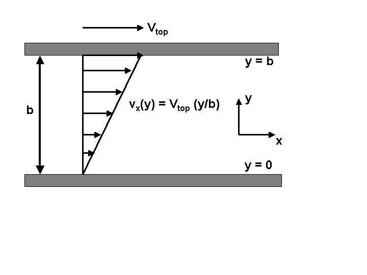
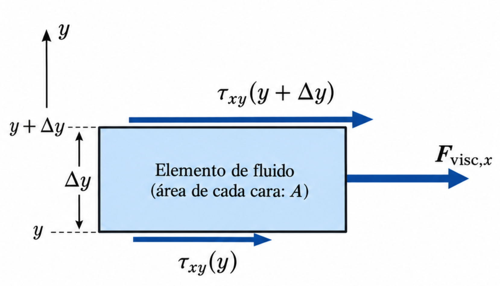
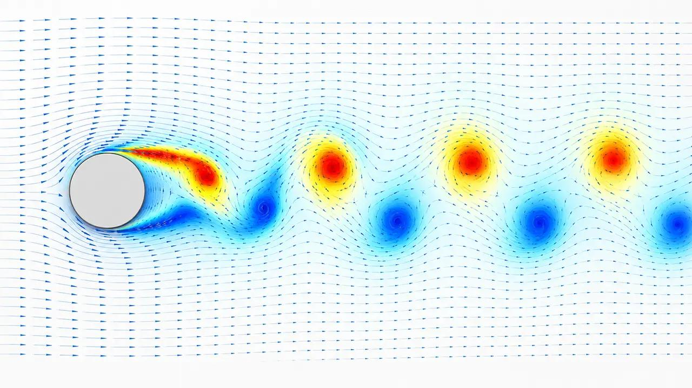

> **Idea conductora.** Partimos de una ley muy sencilla, $\vec F=m\vec a$, para construir una ecuación que modela el movimiento de los fluidos. Podemos aproximar numéricamente muchas de sus soluciones, pero entender rigurosamente qué ocurre con _todas_ ellas plantea dificultades enormes. El reciente resultado presentado por OpenAI permite terminar con una discusión sobre simulación, demostración matemática e inteligencia artificial.

## 1. Construir Navier–Stokes desde Newton

### 1.1. El problema físico

$$
\boxed{\vec F=m\vec a}
$$

**Pregunta:** _¿Podemos utilizar esta ley para predecir cómo se mueve el agua alrededor de un obstáculo, o cómo circula el aire?_

En principio, sí. Pero no vamos a seguir las trayectorias de cada molécula: para eso necesitaríamos describir un número astronómico de grados de libertad. Usaremos la **aproximación de medio continuo**.

Imaginemos una pequeña porción de agua, a la que llamaremos **elemento material** o **partícula fluida**. No es una molécula: contiene muchas moléculas, aunque es suficientemente pequeña para asignarle una densidad y una velocidad local.

Si ocupa un volumen $\Delta V$, su masa es aproximadamente

$$
\Delta m=\rho\,\Delta V.
$$

Aplicamos Newton:

$$
\rho\,\Delta V\,\vec a=\sum\vec F.
$$

Al dividir por el volumen:

$$
\rho\,\vec a=\text{fuerza neta por unidad de volumen}.
$$

Nos faltan dos ingredientes: **qué fuerzas actúan** y **cómo calculamos la aceleración**.

### 1.2. Primera fuerza: la presión

Tomemos un cubito de fluido de caras paralelas a los ejes. En la cara izquierda la presión empuja hacia la derecha; en la cara derecha empuja hacia la izquierda. Si las presiones fueran iguales, las fuerzas se compensarían.

En una dimensión, para un cubito con área transversal $A$ y espesor $\Delta x$:

$$
F_{p,x}=p(x)A-p(x+\Delta x)A.
$$

Al dividir por el volumen $A\Delta x$ y tomar el límite:

$$
\frac{F_{p,x}}{\Delta V}=-\frac{\partial p}{\partial x}.
$$

En tres dimensiones:

$$
\boxed{\vec f_{\mathrm{presión}}=-\nabla p}.
$$

**Interpretación:** un gradiente de presión produce una fuerza que apunta hacia las presiones menores.

### 1.3. Segunda fuerza: la gravedad

La gravedad actúa sobre la masa del elemento:

$$
\vec F_g=\rho\,\Delta V\,\vec g.
$$

Por unidad de volumen es $\rho\vec g$. Hasta aquí:

$$
\rho\vec a=-\nabla p+\rho\vec g.
$$

Ya tenemos una ecuación que recuerda a la de **Euler** para un fluido ideal, pero todavía no incorporamos la fricción interna.

### 1.4. Tercera fuerza: la viscosidad

**Idea física:** dos capas contiguas de fluido pueden desplazarse con velocidades diferentes. La interacción entre ellas transfiere cantidad de movimiento: la capa rápida arrastra a la lenta y la lenta frena a la rápida.

Pensemos en fluido entre dos placas paralelas: la inferior quieta, la superior avanzando hacia la derecha. La componente horizontal de velocidad $v_x$ varía con la altura $y$.

En un fluido **newtoniano**, el esfuerzo tangencial entre capas es proporcional al gradiente de velocidad:

$$
\boxed{\tau_{xy}=\mu\frac{\partial v_x}{\partial y}},
$$

donde $\mu$ es la **viscosidad dinámica**, con unidades $\mathrm{Pa\,s}$.

¿Por qué termina apareciendo una **segunda derivada** en la ecuación del movimiento?

Tomemos una lámina de fluido de espesor $\Delta y$ y área $A$. En sus caras superior e inferior actúan esfuerzos tangenciales distintos. La fuerza neta horizontal es

$$
F_{\mathrm{visc},x}
=A\left[\tau_{xy}(y+\Delta y)-\tau_{xy}(y)\right].
$$

Dividimos por $A\Delta y$:

$$
\frac{F_{\mathrm{visc},x}}{\Delta V}
\longrightarrow \frac{\partial\tau_{xy}}{\partial y}
=\mu\frac{\partial^2v_x}{\partial y^2},
$$

suponiendo $\mu$ constante.

**Dos derivadas, dos ideas:**

- Un **gradiente de velocidad** genera un esfuerzo viscoso.
- Un **gradiente de ese esfuerzo** genera una fuerza neta sobre el elemento.

Para un fluido newtoniano **incompresible** y de **viscosidad constante**, el resultado completo en tres dimensiones es

$$
\boxed{\vec f_{\mathrm{visc}}=\mu\nabla^2\vec v}.
$$

Aquí el laplaciano se aplica a cada componente de $\vec v$.

**Una sutileza instructiva:** un perfil _lineal_ de velocidad puede tener esfuerzo viscoso distinto de cero y, sin embargo, laplaciano nulo. Existe rozamiento entre capas, pero las fuerzas de ambas caras de un pequeño elemento pueden equilibrarse.

##### El significado del laplaciano: difusión de cantidad de movimiento

En un flujo unidireccional simple, sin gradiente de presión ni otras fuerzas, la ecuación puede reducirse a

$$
\frac{\partial v_x}{\partial t}
=\nu\frac{\partial^2v_x}{\partial y^2},
\qquad \nu=\frac{\mu}{\rho}.
$$

Es la misma estructura matemática que la ecuación del calor: **la viscosidad difunde cantidad de movimiento y suaviza diferencias de velocidad**. La magnitud $\nu$ se denomina _viscosidad cinemática_ y tiene unidades $\mathrm{m^2/s}$.

Esta conexión permite anticipar algo del curso: el laplaciano se puede aproximar mediante diferencias de valores vecinos en una grilla.

### 1.5. ¿Qué aceleración corresponde poner en Newton?

Esta parte merece hacerse lentamente, porque suele ser la más confusa.

**La velocidad $\vec v(\vec x,t)$ no es un campo externo que «obliga» al fluido a moverse.** Es la descripción del movimiento del propio fluido, asignando una velocidad a cada posición e instante.

Hay dos maneras de describir _el mismo_ movimiento:

- **Euleriana:** fijamos un punto del espacio y medimos la velocidad del agua que va pasando por allí.
- **Lagrangiana:** seguimos una pequeña porción material de agua y registramos su posición y velocidad.

La **partícula fluida** no es una molécula aislada y **el campo no es una entidad independiente de ella**. El campo resume las velocidades de todas esas porciones materiales. Cuando conocemos el campo, podemos reconstruir el recorrido de cada porción.

En una dimensión, si la posición de una porción de fluido es $x_p(t)$:

$$
\frac{dx_p}{dt}=v(x_p(t),t).
$$

Su aceleración es la derivada de _su_ velocidad:

$$
\begin{aligned}
a_p(t)
&=\frac{d}{dt}\,v(x_p(t),t)\\
&=\frac{\partial v}{\partial t}
+\frac{\partial v}{\partial x}\frac{dx_p}{dt}\\
&=\frac{\partial v}{\partial t}
+v\frac{\partial v}{\partial x}.
\end{aligned}
$$

**No añadimos una nueva fuerza:** solo aplicamos la regla de la cadena para pasar de la descripción en puntos fijos a la aceleración de una porción material.

Pensemos en un conducto que se estrecha. El flujo es estacionario: en cada punto la velocidad es siempre la misma, por lo que $\partial v/\partial t=0$. Pero cada porción de agua acelera al avanzar hacia la zona angosta, porque llega a posiciones donde la velocidad es mayor. Por eso puede ocurrir

$$
\frac{\partial v}{\partial t}=0
\quad\text{y sin embargo}\quad
\frac{dv_p}{dt}\neq 0.
$$

En tres dimensiones, la regla de la cadena da la **derivada material**:

$$
\boxed{
\frac{D\vec v}{Dt}
=\frac{\partial\vec v}{\partial t}
+(\vec v\cdot\nabla)\vec v
}.
$$

El segundo término es **convectivo** y es **no lineal**, porque intervienen la velocidad y sus derivadas multiplicándose entre sí.

**Distinción fundamental:** la derivada material es una relación **cinemática** que expresa la aceleración de la materia; Navier–Stokes es una relación **dinámica** que usa Newton para relacionar esa aceleración con las fuerzas.

### 1.6. Juntamos todo

Aplicamos Newton al elemento material, reemplazando fuerzas y aceleración:

$$
\rho\left[
\frac{\partial\vec v}{\partial t}
+(\vec v\cdot\nabla)\vec v
\right]
=-\nabla p+\mu\nabla^2\vec v+\rho\vec g.
$$

Dividimos por la densidad y definimos $\nu=\mu/\rho$:

$$
\boxed{
\frac{\partial\vec v}{\partial t}
+(\vec v\cdot\nabla)\vec v
=-\frac{1}{\rho}\nabla p
+\nu\nabla^2\vec v+\vec g
}.
$$

Para cerrar el modelo, en un fluido incompresible de densidad constante exigimos además

$$
\boxed{\nabla\cdot\vec v=0}.
$$

Esta última ecuación proviene de la **conservación de la masa**: un pequeño volumen de fluido no puede acumular ni perder masa por compresión.

| Término                     | Significado                                                   |
| --------------------------- | ------------------------------------------------------------- |
| $\partial\vec v/\partial t$ | Cambio de velocidad observado en un punto fijo                |
| $(\vec v\cdot\nabla)\vec v$ | Cambio de velocidad por desplazarse a través del propio flujo |
| $-\nabla p/\rho$            | Aceleración debida a diferencias de presión                   |
| $\nu\nabla^2\vec v$         | Redistribución viscosa de cantidad de movimiento              |
| $\vec g$                    | Gravedad u otra aceleración externa uniforme                  |
| $\nabla\cdot\vec v=0$       | Restricción de incompresibilidad                              |

En pocos pasos construimos una ecuación a partir de Newton, pero ahora tenemos una ecuación diferencial parcial no lineal, para la cual necesitamos condiciones iniciales y de contorno. Escribirla no significa saber resolverla.

---

## 2. Análisis dimensional: ¿qué determina el comportamiento?

Podemos identificar mecanismos dominantes antes de resolver el problema.

Dejemos de lado las fuerzas externas para concentrarnos en inercia y viscosidad.

Tomamos dos escalas características:

- $U$: velocidad típica del flujo $[U]=L/T$.
- $L$: longitud típica del problema $[L]=L$.

Una derivada espacial representa aproximadamente una variación dividida por una distancia:

$$
\nabla\sim\frac{1}{L}.
$$

Por lo tanto, el término convectivo tiene orden de magnitud

$$
(\vec v\cdot\nabla)\vec v\sim\frac{U^2}{L},
$$

mientras que el viscoso tiene orden

$$
\nu\nabla^2\vec v\sim\frac{\nu U}{L^2}.
$$

El cociente entre ambos es

$$
\boxed{
Re=\frac{U^2/L}{\nu U/L^2}=\frac{UL}{\nu}
}.
$$

Es el **número de Reynolds**, adimensional.

- Si $Re\ll1$, en esas escalas la viscosidad tiene un papel dominante frente a la inercia convectiva.
- Si $Re\gg1$, la inercia convectiva es grande frente a la contribución viscosa estimada en esa escala. **Esto no significa que la viscosidad sea irrelevante en todas partes**, especialmente cerca de superficies.
- Reynolds alto **no equivale** automáticamente a turbulencia ni a una singularidad.

##### Otra manera de interpretarlo: comparar tiempos

Un elemento tarda aproximadamente $t_{\mathrm{adv}}\sim L/U$ en recorrer la longitud característica. La difusión viscosa actúa en una escala de tiempo $t_{\mathrm{visc}}\sim L^2/\nu$.

$$
\boxed{\frac{t_{\mathrm{visc}}}{t_{\mathrm{adv}}}=\frac{UL}{\nu}=Re}.
$$

Esta es una interpretación muy tangible: **comparamos cuánto tarda el movimiento en transportar algo con cuánto tarda la viscosidad en suavizarlo**.

##### La ecuación sin unidades

Tomemos

$$
\vec x=L\vec x',\qquad
 t=\frac{L}{U}t',\qquad
\vec v=U\vec v',\qquad
p=\rho U^2p'.
$$

Sin gravedad, queda

$$
\boxed{
\frac{\partial\vec v'}{\partial t'}
+(\vec v'\cdot\nabla')\vec v'
=-\nabla'p'+\frac{1}{Re}\nabla'^2\vec v'
}.
$$

Así se ve por qué $Re$ aparece como parámetro natural del problema, una vez fijados la geometría y los datos adimensionales.

**Conexión con FisCom:** antes de programar conviene saber qué parámetros controlan el problema, qué escalas habrá que resolver y cómo comparar simulaciones distintas.

> **Pregunta a los estudiantes:** «¿Qué esperarían si duplicamos la velocidad de entrada manteniendo el mismo fluido y la misma geometría?».

---

## 3. Existencia y regularidad: el problema del milenio

**Pregunta:** _Si las ecuaciones se conocen desde el siglo XIX y se usan en simulaciones todos los días, ¿qué es lo que todavía era tan difícil?_

### 3.1. ¿Qué significa regularidad?

Partimos de un campo inicial de velocidades $\vec v_0(\vec x)$ **suave**, sin discontinuidades, y compatible con la incompresibilidad.

**Regularidad** significa, en términos intuitivos, que el campo de velocidades y las derivadas que requiere la ecuación siguen estando bien definidos y no desarrollan singularidades. La formulación de Clay pide soluciones suaves (_$C^\infty$_) para todos los tiempos, con las condiciones adicionales especificadas para el dominio considerado.

La dificultad es demostrar que, a partir de datos iniciales admisibles, una solución permanece suave para **todo** $t\geq0$; no alcanza con que sea regular durante un intervalo corto.

Una **singularidad en tiempo finito** (_blow-up_) puede significar, por ejemplo, que la velocidad crezca sin cota cuando $t$ se acerca a un instante $T<\infty$.

Conviene subrayar tres diferencias:

- **Turbulencia no es singularidad:** un flujo puede ser caótico y muy complejo sin perder regularidad matemática.
- **Un gradiente muy grande no es lo mismo que una divergencia matemática.**
- **Energía total finita no garantiza velocidad máxima finita:** un fenómeno puede concentrarse en una región espacial cada vez más pequeña.

### 3.2. ¿Qué preguntó exactamente el Clay Mathematics Institute?

En 2000, el instituto incorporó la cuestión de existencia y regularidad de Navier–Stokes en **tres dimensiones** a sus problemas del milenio. Su formulación oficial acepta demostrar _alguna_ de estas cuatro afirmaciones:

|                                                                                                              | Espacio completo $\mathbb R^3$ | Dominio espacial periódico $\mathbb T^3$ |
| ------------------------------------------------------------------------------------------------------------ | ------------------------------ | ---------------------------------------- |
| **Existencia y suavidad global** para todos los datos iniciales admisibles, **sin fuerza externa**           | A                              | B                                        |
| **Contraejemplo a la suavidad global** para ciertos datos iniciales y una **fuerza externa suave admisible** | C                              | D                                        |

La segunda fila no dice que _cualquier_ fuerza suave produzca una singularidad; dice que basta **construir al menos un caso** bajo las hipótesis de Clay.

En dos dimensiones existen teoremas de regularidad global para problemas clásicos correspondientes. En tres dimensiones sabemos obtener soluciones suaves locales en el tiempo; también existen soluciones débiles globales, pero eso por sí solo no asegura suavidad y unicidad en general.

**Contraste:** una computadora puede calcular una solución aproximada en un dominio, con una malla, condiciones iniciales y un tiempo de simulación concretos. Una demostración matemática trata afirmaciones generales acerca de toda una clase de soluciones.

**Fuente:** [Charles L. Fefferman, _Existence and Smoothness of the Navier–Stokes Equation_, enunciado oficial del Clay Mathematics Institute](https://www.claymath.org/wp-content/uploads/2022/06/navierstokes.pdf).

---

## 4. Mostrar una simulación numérica

Podemos explorar una solución aproximada con [VisualPDE — Navier–Stokes 2D](https://canary.visualpde.com/fluids/navier_stokes/) y, en particular, el [flujo alrededor de un cilindro](https://canary.visualpde.com/sim/?preset=NavierStokesFlowCylinder).

En el ejemplo del cilindro se observa cómo el flujo se desvía alrededor del obstáculo y cómo, bajo ciertas condiciones, la estela puede volverse inestable y desprender **vórtices alternados**.

**¿Qué resolvió exactamente la computadora?** No manipuló una función continua exacta. Trabajó con una **aproximación numérica**, con una discretización espacial y temporal, condiciones iniciales y de contorno, y un método para actualizar los valores. El recurso usa una formulación numérica particular para aproximar el problema incompresible; no es una prueba matemática de existencia o regularidad.

##### Conexión inmediata con el curso

La pregunta deja servidos varios temas de FisCom:

- Cómo aproximar derivadas espaciales (por ejemplo, el laplaciano).
- Cómo avanzar una solución en el tiempo.
- Cómo imponer condiciones de contorno.
- Cómo determinar estabilidad, error y convergencia numérica.

La simulación parece resolver Navier–Stokes. Pero ¿garantiza que para cualquier dato inicial razonable la solución matemática sea suave para siempre? No.

---

## 5. El resultado anunciado por OpenAI en septiembre de 2026

**Contexto y estado del resultado al 16 de octubre de 2026.** El 8 de septiembre, OpenAI publicó una demostración analítica acompañada de una formalización en **Lean**, que presenta una construcción de una solución de Navier–Stokes tridimensional que desarrolla velocidades sin cota en tiempo finito. El 11 de septiembre, Clay indicó que el problema _aparentemente_ había sido resuelto, pero aclaró que la evaluación formal llevaría tiempo. **La aceptación institucional definitiva no debe darse por concluida.**

**Fuentes:** [presentación de OpenAI](https://openai.com/es-419/index/navier-stokes-solution/), [artículo técnico](https://cdn.openai.com/pdf/32d9f210-8b73-45e0-91bc-82a30aef8a9a/navier-stokes.pdf), [formalización en Lean](https://github.com/openai/NavierStokesAndEuler) y [comunicado de Clay](https://www.claymath.org/news/navier-stokes-announcement/).

### 5.1. ¿Qué es lo que se construyó?

Según el trabajo presentado, se obtiene un ejemplo que:

- Empieza **desde el reposo**, con campo inicial de velocidades nulo.
- Recibe una **fuerza externa suave**, diseñada cuidadosamente y con soporte acotado.
- Tiene una solución suave hasta antes de cierto tiempo $T$.
- Desarrolla una velocidad máxima que crece sin límite al acercarse a $T$.
- Mantiene **acotada la energía cinética total** durante ese proceso.

El resultado apunta a las alternativas **C y D** del enunciado de Clay.

**Punto que no se debe confundir:** no demuestra que Navier–Stokes _sin_ fuerza externa produzca singularidades, ni demuestra que las soluciones _sin_ fuerza externa sean siempre regulares. El contraejemplo usa una fuerza externa suave; eso está permitido explícitamente en C y D.

### 5.2. ¿Cómo puede crecer indefinidamente la velocidad sin que la energía diverja?

La energía cinética del fluido es proporcional a

$$
E(t)=\frac{\rho}{2}\int |\vec v(\vec x,t)|^2\,d^3x.
$$

Como intuición dimensional, si una región tiene volumen característico $V(t)$ y velocidad característica $U(t)$, su contribución a la energía escala como

$$
E_{\mathrm{región}}\sim\rho\,U(t)^2V(t).
$$

Es posible que $U(t)$ aumente mientras $V(t)$ se contrae lo suficiente para que el producto no diverja. **Esta cuenta no prueba el resultado**, pero permite entender por qué una velocidad máxima ilimitada no contradice necesariamente la finitud de la energía integral.

En el mecanismo construido por OpenAI hay una región central del flujo que se contrae y se alarga en distintas direcciones; los detalles de esa estructura vorticial no son necesarios para esta apertura. Lo importante es que la fuerza externa debe mantenerse suave **a pesar** de la singularidad de la velocidad, algo que requiere cancelaciones matemáticas delicadas entre los términos de la ecuación.

### 5.3. ¿Dónde entra la computación y dónde entra la IA?

OpenAI informó que un sistema multiagente exploró el problema con unos **10.000 agentes simultáneos** en el grupo que produjo el resultado. Reportó cerca de **88 horas** hasta encontrar la demostración y unas **17 horas** adicionales para su formalización y verificación en Lean. Estas son cifras comunicadas por OpenAI, no una reconstrucción independiente del proceso.

Esto permite diferenciar **tres actividades computacionales**:

| Actividad                                      | Qué produce                                                                   | Qué no garantiza por sí sola                                                                                                    |
| ---------------------------------------------- | ----------------------------------------------------------------------------- | ------------------------------------------------------------------------------------------------------------------------------- |
| **Simulación numérica**                        | Aproximación del movimiento para un caso concreto                             | Un teorema válido para todos los datos y tiempos                                                                                |
| **Búsqueda de demostraciones asistida por IA** | Conjeturas, construcciones, argumentos y posibles pruebas                     | Que todos los pasos sean correctos                                                                                              |
| **Formalización en Lean**                      | Una cadena de pasos verificable contra reglas lógicas y definiciones formales | Que la formalización capture automáticamente la intención del teorema sin necesidad de revisar sus hipótesis y correspondencias |

**Cierre de la discusión:** la simulación, la demostración analítica y la verificación formal son maneras muy diferentes de producir conocimiento sobre la misma ecuación.

---

## 6. Cierre de la introducción

> **¿Qué significa, en física computacional, «resolver una ecuación»?**

En esta misma historia encontramos respuestas diferentes:

1. **Construir el modelo:** aplicar Newton a un medio continuo y formular las leyes constitutivas.
2. **Comprender sus escalas:** usar el análisis dimensional para identificar parámetros, como Reynolds.
3. **Calcular soluciones particulares:** discretizar el problema y aproximar su evolución en una computadora.
4. **Demostrar resultados generales:** establecer rigurosamente existencia, regularidad o ruptura bajo hipótesis precisas.

> «Partimos de $F=ma$ y terminamos en un problema que exigió casi dos siglos de matemática, simulación y, ahora, herramientas de inteligencia artificial. El objetivo de FisCom es aprender a construir y explorar esa conexión entre modelos físicos y computación, sabiendo también qué nos permiten afirmar —y qué no— nuestros resultados numéricos».
