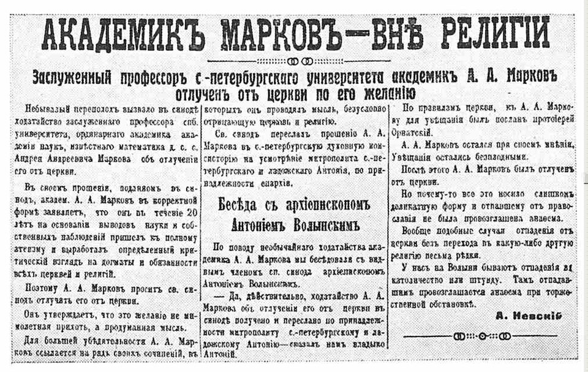
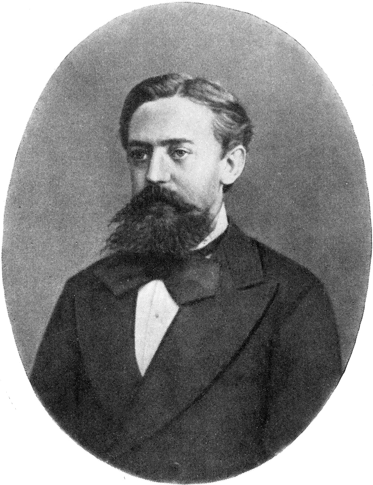

> **Pregunta de la clase.** ¿Cuándo una regla local y aleatoria produce un
> comportamiento colectivo predecible, y cuándo lo describe bien una ecuación
> diferencial sin azar?

En la clase anterior Metropolis generó una sucesión de estados en la que cada
uno depende sólo del anterior: una cadena de Markov. Hoy miramos esas cadenas
de frente. Primero, una cadena con pocos estados, donde todo se puede calcular
con una matriz. Después, el caminante aleatorio, que es la puerta a la
ecuación de difusión de la clase 08. Por último, un modelo de agentes: una
epidemia en la que cada persona sigue una regla al azar, y que comparamos con
una ecuación diferencial sin azar (la de campo medio), que se integra con lo
visto en las clases 00 a 02.

```{python}
#| label: imports
#| include: false

import numpy as np
import matplotlib.pyplot as plt
from IPython.display import HTML
from matplotlib import animation
from matplotlib.colors import ListedColormap
from scipy.integrate import solve_ivp
from scipy.optimize import brentq
from scipy.stats import binom


def animar(figura, actualizar, cuadros, intervalo=80):
    """Animación de matplotlib embebida en la página, sin depender de ffmpeg."""
    pelicula = animation.FuncAnimation(figura, actualizar, frames=cuadros, interval=intervalo)
    html = pelicula.to_jshtml(default_mode="loop")
    plt.close(figura)
    return HTML(html)
```

## 1. Cadenas de Markov con pocos estados

Una cadena de Markov con estados $1,\dots,m$ queda definida por su **matriz
de transición**. Usamos la convención

$$
P_{ij}=\Pr(X_{t+1}=i\mid X_t=j),
$$

donde $j$ es el estado de partida e $i$ el de llegada. Cada columna es una
distribución de probabilidad: sus elementos son no negativos y suman uno. Si
$p_t$ es el vector columna con la probabilidad de cada estado en el paso $t$,

$$
p_{t+1}=P\,p_t ,\qquad\text{es decir}\qquad p_{t+1}(i)=\sum_j P_{ij}\,p_t(j).
$$

Es la forma de la ecuación maestra en física. Algunos textos de probabilidad
usan la convención traspuesta, con vectores fila y $p_{t+1}=p_tP$: es la misma
cadena con la matriz traspuesta.

**Ojo con el orden de los índices.** Con la notación de la clase 06,
$P_{ij}=P(j\to i)$: el primer índice es el de **llegada**, y se lee de derecha
a izquierda, como en $Pp_t$. El balance detallado de la clase 06,
$\pi(j)\,P(j\to i)=\pi(i)\,P(i\to j)$, se escribe

$$
P_{ij}\,\pi_j=P_{ji}\,\pi_i ,
$$

es decir, la matriz de flujos $P_{ij}\pi_j$, la probabilidad que pasa de $j$ a
$i$ en un paso, es simétrica.

Como ejemplo usamos Metropolis sobre cinco niveles de energía $E_i=i$, a
temperatura $T=1$. La propuesta es subir o bajar un nivel con probabilidad
$1/2$; si sale de la escalera, se rechaza.

```{python}
#| label: matriz

def matriz_metropolis(energias, T):
    """Matriz de transición de Metropolis con propuesta a un nivel vecino.

    P[i, j] es la probabilidad de pasar del nivel j al nivel i.
    """
    m = len(energias)
    P = np.zeros((m, m))
    for j in range(m):
        for i in (j - 1, j + 1):
            if 0 <= i < m:
                P[i, j] = 0.5 * min(1.0, np.exp(-(energias[i] - energias[j]) / T))
        P[j, j] = 1 - P[:, j].sum()  # rechazos: el estado se repite
    return P


energias = np.arange(5.0)
T = 1.0
P = matriz_metropolis(energias, T)
print(np.round(P, 3))
print("las columnas suman uno:", np.allclose(P.sum(axis=0), 1))
```

### 1.1. La distribución estacionaria es un autovector

Una distribución que no cambia al aplicar la cadena cumple $P\pi=\pi$: es un
autovector de $P$ con autovalor uno. La construcción de Metropolis garantiza que sea la
distribución de Boltzmann. Lo controlamos de dos maneras independientes: con
el autovector y con una cadena simulada.

```{python}
#| label: estacionaria

autovalores, autovectores = np.linalg.eig(P)
orden = np.argsort(-np.abs(autovalores))  # de mayor a menor módulo
autovalores, autovectores = autovalores[orden].real, autovectores[:, orden].real
pi = autovectores[:, 0] / autovectores[:, 0].sum()
boltzmann = np.exp(-energias / T) / np.exp(-energias / T).sum()

flujo = P * pi[None, :]  # flujo[i, j]: probabilidad que pasa de j a i en el estacionario
print("autovalores:", np.round(autovalores, 4))
print("π del autovector:", np.round(pi, 4))
print("Boltzmann:       ", np.round(boltzmann, 4))
print("balance detallado, flujo simétrico:", np.allclose(flujo, flujo.T))


def simular_cadena(P, estado, pasos, rng):
    """Una realización de la cadena: en cada paso sortea el siguiente estado con la columna de P."""
    acumulada = np.cumsum(P, axis=0)
    sorteos = rng.random(pasos)
    estados = np.empty(pasos, dtype=int)
    for k in range(pasos):
        estado = min(np.searchsorted(acumulada[:, estado], sorteos[k], side="right"), len(P) - 1)
        estados[k] = estado
    return estados


estados = simular_cadena(P, 4, 100_000, np.random.default_rng(2026))
print("frecuencias de la cadena:", np.round(np.bincount(estados, minlength=5) / len(estados), 4))
```

El autovalor 1 corresponde a $\pi$. Hay otros cuatro, uno de ellos negativo.
No son probabilidades: ¿qué son?

### 1.2. Qué significan los otros autovalores

Ordenamos los autovalores por módulo, de mayor a menor. El subíndice indica
ese orden: $\lambda_2$ es el segundo en módulo, no una transición del estado 1
al 2.

**El primero es $\lambda_1=1$, y su autovector es $\pi$.**

- **Ningún autovalor tiene módulo mayor que uno.** Si $Pv=\lambda v$, tomando
  módulos componente a componente,
  $|\lambda|\sum_i|v(i)|\le\sum_i\sum_jP_{ij}|v(j)|=\sum_j|v(j)|$, porque las
  columnas de $P$ suman uno. Entonces $|\lambda|\le1$: aplicar la cadena no
  puede amplificar nada.
- **El 1 sí es autovalor**, y su autovector es la distribución estacionaria de
  la sección 1.1: $P\pi=\pi$.
- **Un autovector está definido salvo un factor.** De todos los múltiplos,
  elegimos el que suma uno; así $v_1$ es exactamente $\pi$. Es lo que hace el
  código cuando divide por `autovectores[:, 0].sum()`.

Que el 1 aparezca **una sola vez**, y con él una sola distribución
estacionaria, requiere que la cadena pueda llegar de cualquier estado a
cualquier otro. El ejemplo de dos estados, más abajo, muestra qué pasa si no.

Los autovectores $v_1=\pi,v_2,\dots,v_m$ de $P$ forman una base: con balance
detallado, $P$ es diagonalizable. Entonces cualquier distribución inicial se
escribe como combinación de ellos,

$$
p_0=\sum_{k=1}^{m}c_k\,v_k ,
$$

donde los $c_k$ son las **coordenadas de $p_0$ en la base de autovectores**.
Dependen sólo de la condición inicial, y se obtienen resolviendo el sistema
lineal $Vc=p_0$, con los $v_k$ como columnas de $V$.

El coeficiente de $\pi$ es siempre el mismo, $c_1=1$, por dos razones:

1. **Cada $v_k$ con $k\ge2$ suma cero.** Sumamos las componentes de
   $Pv_k=\lambda_kv_k$. A la izquierda,
   $\sum_i\sum_jP_{ij}v_k(j)=\sum_jv_k(j)$, porque cada columna de $P$ suma
   uno. A la derecha queda $\lambda_k\sum_jv_k(j)$. Entonces
   $(1-\lambda_k)\sum_jv_k(j)=0$, y si $\lambda_k\neq1$ la suma es cero.
2. **Sumamos las componentes de $p_0=\sum_kc_kv_k$.** A la izquierda queda 1,
   porque $p_0$ es una distribución. A la derecha, los $v_k$ con $k\ge2$ no
   aportan, y queda $c_1\sum_i\pi_i=c_1$. Entonces $c_1=1$.

Como $Pv_k=\lambda_kv_k$, aplicar la cadena $t$ veces multiplica cada
coordenada por su autovalor:

$$
p_t=P^tp_0=\pi+\sum_{k\ge2}c_k\,\lambda_k^t\,v_k .
$$

- **Cada $v_k$ con $k\ge2$ es una redistribución, no una distribución.**
  Como suma cero, saca probabilidad de unos estados y la pone en otros. Por
  eso tiene componentes negativas.
- **$\lambda_k$ es el factor por el que esa redistribución se multiplica en
  cada paso.** Si además la cadena no oscila con un período fijo,
  $|\lambda_k|<1$ para $k\ge2$: todas se apagan y queda $\pi$.
- **El signo.** Si $\lambda_k>0$, el exceso en unos estados decae sin cambiar
  de signo. Si $\lambda_k<0$, cambia de signo en cada paso: la probabilidad va
  y vuelve entre estados, cada vez menos. El $-0.17$ de arriba es un modo así,
  que se reduce un factor seis por paso.
- **Son reales** porque la cadena cumple balance detallado. Una cadena sin
  balance detallado puede tener autovalores complejos: la probabilidad gira
  entre estados.

**Un ejemplo con dos estados.** La matriz más general es

$$
P=\begin{pmatrix}1-a & b\\ a & 1-b\end{pmatrix},
\qquad \lambda_1=1,\quad \lambda_2=1-a-b ,
$$

donde $a$ es la probabilidad de pasar del estado 1 al 2, y $b$ la de pasar del
2 al 1.

| $a$, $b$ | $\lambda_2$ | Qué hace la cadena |
| --- | ---: | --- |
| $a=b=0$ | $1$ | no se mueve: nunca olvida dónde empezó |
| $a+b$ chico | cerca de $1$ | cambia de estado rara vez: olvida lento |
| $a+b=1$ | $0$ | el estado siguiente no depende del actual: olvida en un paso |
| $a+b$ cerca de $2$ | cerca de $-1$ | casi siempre cambia: alterna, y olvida lento |
| $a=b=1$ | $-1$ | alterna para siempre: nunca olvida |

Los dos extremos son las dos maneras de fallar. Si la cadena no puede llegar
de cualquier estado a cualquier otro, hay más de un autovalor igual a 1 y más
de una distribución estacionaria. Si oscila con un período fijo, aparece un
autovalor $-1$ y la distribución nunca converge.

### 1.3. Cuánto tarda en olvidar

Arrancamos con toda la probabilidad en el nivel más alto,
$p_0=(0,0,0,0,1)$, y miramos cómo se acerca $p_t$ a $\pi$.

**Antes de correr:** ¿cuántos pasos esperan que tarde la distribución en
parecerse a $\pi$ con un error de $10^{-6}$?

Primero descomponemos $p_0$ en modos, como en la sección 1.2. Normalizamos cada
$v_k$ con $k\ge2$ para que $\sum_i|v_k(i)|=1$, de modo que las amplitudes
$c_k\lambda_k^t$ de los distintos modos sean comparables. Calculamos esas
amplitudes y controlamos que
$\pi+\sum_{k\ge2}c_k\lambda_k^tv_k$ coincida con $P^tp_0$ calculado paso a
paso.

```{python}
#| label: modos

p0 = np.zeros(5)
p0[4] = 1.0
V = autovectores / np.abs(autovectores).sum(axis=0)  # cada modo con Σ|v_k| = 1
V[:, 0] = pi  # v_1 = π, que suma uno
c = np.linalg.solve(V, p0)  # coordenadas de p_0 en la base de autovectores
print(f"c_1 = {c[0]:.6f}")

pasos_modos = np.arange(16)
amplitudes = c * autovalores ** pasos_modos[:, None]  # c_k λ_k^t, con forma (pasos, modos)

p = p0.copy()
p_pasos = []
for t in pasos_modos:
    p_pasos.append(p)
    p = P @ p
p_pasos = np.array(p_pasos)
print(f"diferencia máxima entre modos y P^t p_0: {np.abs(amplitudes @ V.T - p_pasos).max():.1e}")

print("\n  t " + "".join(f"   λ = {l:+.3f}" for l in autovalores[1:]))
for t in (0, 1, 2, 3, 5, 10, 15):
    print(f"{t:>3} " + "".join(f"{a:>13.1e}" for a in amplitudes[t, 1:]))
```

```{python}
#| label: fig-modos
#| fig-cap: "Izquierda: distribución en algunos pasos, arrancando desde el nivel más alto, frente a la estacionaria. Derecha: amplitud |c_k λ_k^t| de cada modo; los marcadores vacíos indican amplitud negativa."
#| code-fold: true
#| code-summary: "Código de la figura"

fig, (ax_p, ax_m) = plt.subplots(1, 2, figsize=(9.5, 3.6))
for k, t in enumerate((0, 1, 3, 10)):
    ax_p.bar(energias + 0.18 * (k - 1.5), p_pasos[t], width=0.18, label=f"$t={t}$")
ax_p.plot(energias, pi, "k_", ms=18, mew=2, label="$\\pi$")
ax_p.set(xlabel="nivel $E_i$", ylabel="$p_t(i)$")
ax_p.legend(fontsize=8)
for k in range(1, 5):
    a = amplitudes[:, k]
    color = f"C{k - 1}"
    ax_m.semilogy(pasos_modos, np.abs(a), "-", color=color, lw=0.8,
                  label=f"$\\lambda_{k + 1}={autovalores[k]:+.2f}$")
    positivos = a > 0
    ax_m.semilogy(pasos_modos[positivos], a[positivos], "o", color=color, ms=4)
    ax_m.semilogy(pasos_modos[~positivos], -a[~positivos], "o", color=color, ms=4, mfc="none")
ax_m.set(xlabel="paso $t$", ylabel="$|c_k\\lambda_k^t|$", ylim=(1e-12, 10))
ax_m.legend(fontsize=8)
for ax in (ax_p, ax_m):
    ax.grid(alpha=0.25)
fig.tight_layout()
plt.show()
```

En $t=0$ las amplitudes son mayores que uno: los modos no son ortogonales y
se cancelan entre sí para dar $p_0-\pi$. Como cada uno decae a su propio
ritmo, la cancelación se pierde enseguida. Cada modo es una recta en escala
logarítmica, con pendiente $\ln|\lambda_k|$:

- el de $\lambda=-0.17$ cambia de signo en cada paso y en tres pasos es más
  de cien veces menor;
- el de $\lambda=0.13$ es siempre negativo, porque lo es su coeficiente $c_k$,
  y decae todavía más rápido;
- el de $\lambda=0.50$ se reduce a la mitad por paso;
- el de $\lambda_2=0.81$ es el más lento.

Después de unos pocos pasos sólo queda el de $\lambda_2$, y

$$
p_t-\pi\approx c_2\lambda_2^t\,v_2,\qquad
|\lambda_2|^t=e^{-t/\tau},\qquad
\tau=-\frac{1}{\ln|\lambda_2|}\approx\frac{1}{1-|\lambda_2|}.
$$

La **brecha espectral absoluta** es $1-|\lambda_2|$. Mide qué tan cerca del
módulo uno queda el modo no estacionario más lento; no es, en general, la
distancia geométrica entre dos autovalores. Su inversa es, aproximadamente, el
número de pasos que tarda la cadena en olvidar.

Para contestar la predicción seguimos aplicando $P$ y medimos la distancia
total a $\pi$.

```{python}
#| label: convergencia

p = p0.copy()
distancias = []
for t in range(100):
    distancias.append(np.abs(p - pi).sum())
    p = P @ p
distancias = np.array(distancias)
lambda2 = abs(autovalores[1])
tau = -1 / np.log(lambda2)
print(f"|λ2| = {lambda2:.4f}, brecha espectral 1 − |λ2| = {1 - lambda2:.4f}, τ = {tau:.1f} pasos")
print(f"primer paso con distancia < 1e-6: {np.argmax(distancias < 1e-6)}")
```

Llegar a $10^{-6}$ son unos $\tau\ln10^6\approx14\,\tau$ pasos, más lo que
agrega el prefactor $c_2v_2$, que depende de la condición inicial.

**La termalización.** Arrancar una cadena en un estado fijo es partir de $p_0$
concentrada en ese estado. La distancia que acabamos de calcular es entonces
cuán lejos de $\pi$ está la cadena después de $t$ pasos: es la
**termalización** de la clase 06.

**La correlación.** Lo mismo ocurre en el equilibrio. Si sabemos que la cadena
está en el estado $j$, la distribución $k$ pasos después es la columna $j$ de
$P^k$, que se relaja hacia $\pi$ con los mismos modos. En las clases 05 y 06
estimamos la autocorrelación promediando sobre una serie. Con $P$ la podemos
calcular **exacta**. En el equilibrio, la probabilidad de estar en $j$ en el
paso $t$ y en $i$ en el paso $t+k$ es $(P^k)_{ij}\,\pi_j$, de modo que, para
la energía,

$$
\langle E_tE_{t+k}\rangle=\sum_{i,j}E_i\,(P^k)_{ij}\,\pi_j\,E_j,
\qquad
C(k)=\frac{\langle E_tE_{t+k}\rangle-\langle E\rangle^2}{\langle E^2\rangle-\langle E\rangle^2}.
$$

Escribiendo $P^k$ en modos, $C(k)$ es una suma de términos $\lambda_l^k$, con
$l\ge2$, dominada a retrasos largos por $\lambda_2^k$. Con $C(k)$ exacta
calculamos también el tiempo de autocorrelación integrado de la clase 06,
$\tau_\text{int}=\frac12+\sum_{k\ge1}C(k)$.

```{python}
#| label: autocorrelacion-exacta

media = pi @ energias
varianza = pi @ energias**2 - media**2
retrasos = np.arange(201)
C = np.empty(len(retrasos))
Pk = np.eye(5)  # P^k, empezando por k = 0
for k in retrasos:
    C[k] = (energias @ Pk @ (pi * energias) - media**2) / varianza
    Pk = P @ Pk
tau_int = 0.5 + C[1:].sum()
print(f"C(1) = {C[1]:.4f}, C(5) = {C[5]:.4f}, C(20) = {C[20]:.2e}")
print(f"τ_int = {tau_int:.2f} pasos   τ = −1/ln|λ2| = {tau:.2f} pasos")
```

```{python}
#| label: fig-convergencia
#| fig-cap: "Izquierda: distancia entre la distribución en el paso t y la estacionaria, arrancando desde el nivel más alto. Derecha: autocorrelación exacta de la energía en el equilibrio. En los dos casos, la línea discontinua decae como |λ2|^t."
#| code-fold: true
#| code-summary: "Código de la figura"

pasos_t = np.arange(len(distancias))
fig, (ax_p, ax_C) = plt.subplots(1, 2, figsize=(9.5, 3.6))
ax_p.semilogy(pasos_t, distancias, "o", ms=3, label="$\\sum_i |p_t(i)-\\pi_i|$")
ax_p.semilogy(pasos_t, distancias[10] * lambda2 ** (pasos_t - 10), "--", label="$\\propto|\\lambda_2|^t$")
ax_p.set(xlabel="paso $t$", ylabel="distancia")
ax_C.semilogy(retrasos[:31], C[:31], "o", ms=3, label="$C(k)$ exacta")
ax_C.semilogy(retrasos[:31], C[10] * lambda2 ** (retrasos[:31] - 10), "--", label="$\\propto|\\lambda_2|^k$")
ax_C.set(xlabel="retraso $k$", ylabel="autocorrelación de la energía")
for ax in (ax_p, ax_C):
    ax.legend(fontsize=8)
    ax.grid(alpha=0.25)
fig.tight_layout()
plt.show()
```

En este ejemplo las dos curvas decaen con la misma pendiente: **el modo lento
tiene peso tanto en la termalización como en la correlación de la energía**.
En general, un observable o una condición inicial que no se acople a ese modo
puede decaer más rápido. $\tau$ y $\tau_\text{int}$ no son el mismo número:
$\tau$ es la escala del decaimiento más lento, y $\tau_\text{int}$ suma el área
bajo toda la curva $C(k)$, incluidos los modos rápidos. Es
$\tau_\text{int}$ el que fija la barra de error de un promedio. En la cadena de
cinco estados los calculamos exactos con $P$. En el fluido de la clase 05, con
un continuo de configuraciones en 768 dimensiones, no podemos escribir $P$: por
eso en la clase 06 estimamos el transitorio y $\tau_\text{int}$ a partir de la
serie.

## 2. Caminante aleatorio

### 2.1. Una dimensión

Un caminante en una red unidimensional da un paso a la derecha o a la
izquierda con probabilidad $1/2$. Es una cadena de Markov con infinitos
estados. Simulamos muchos caminantes independientes a la vez.

**Antes de correr:** después de $t$ pasos, ¿cómo crece con $t$ la distancia
típica al origen?

```{python}
#| label: caminantes

rng = np.random.default_rng(1)
caminantes, pasos = 10_000, 1000
x = np.cumsum(rng.choice([-1, 1], size=(pasos, caminantes)), axis=0)

t = np.arange(1, pasos + 1)
dcm_1d = np.mean(x**2, axis=1)
print(f"⟨x²⟩/t en t = {pasos}: {dcm_1d[-1] / pasos:.3f}")
```

```{python}
#| label: fig-caminantes
#| fig-cap: "Izquierda: cinco caminantes en una dimensión durante 1000 pasos; la banda gris es ±√t. Derecha: desplazamiento cuadrático medio de 10 000 caminantes."
#| code-fold: true
#| code-summary: "Código de la figura"

fig, (ax_x, ax_d) = plt.subplots(1, 2, figsize=(9.5, 3.8))
ax_x.fill_between(t, -np.sqrt(t), np.sqrt(t), color="0.85")
for k in range(5):
    ax_x.plot(t, x[:, k], lw=0.7)
ax_x.set(xlabel="pasos $t$", ylabel="$x$")
ax_d.loglog(t, dcm_1d, label="$\\langle x^2\\rangle$")
ax_d.loglog(t, t, "k:", lw=1, label="$t$")
ax_d.set(xlabel="pasos $t$", ylabel="desplazamiento cuadrático medio")
ax_d.legend(fontsize=8)
for ax in (ax_x, ax_d):
    ax.grid(alpha=0.25)
fig.tight_layout()
plt.show()
```

Los pasos son independientes, de modo que las varianzas se suman: después de
$t$ pasos de largo $a$, $\langle x^2\rangle=ta^2$. El desplazamiento
cuadrático medio crece linealmente y la distancia típica,
$\sqrt{\langle x^2\rangle}$, como $\sqrt t$.

### 2.2. De la binomial a la gaussiana

Después de $t$ pasos en una dimensión, si hubo $k$ pasos a la derecha, hubo
$t-k$ a la izquierda. Como cada paso vale $+1$ o $-1$, la posición es

$$
x=k-(t-k)=2k-t.
$$

Por eso la distribución de $x$ se obtiene de la binomial para $k$ y, para
$t$ grande, se acerca a una gaussiana de varianza $t$.

$$
\Pr(k\text{ pasos a la derecha})=\binom{t}{k}
\left(\tfrac12\right)^k\left(\tfrac12\right)^{t-k}
=\binom{t}{k}2^{-t}.
$$

El factor combinatorio cuenta las maneras de elegir cuáles $k$ de los $t$
pasos fueron hacia la derecha. Para una posición dada, reemplazamos
$k=(x+t)/2$:

$$
P_t(x)=
\begin{cases}
\displaystyle \binom{t}{(x+t)/2}2^{-t}, & x+t\text{ es par},\\
0, & x+t\text{ es impar}.
\end{cases}
$$

La segunda línea aparece porque cada paso cambia la paridad de $x$. En los
pasos pares toda la probabilidad está en los sitios pares, y en los impares,
en los sitios impares: la probabilidad alterna entre dos grupos, como en el
caso $a=b=1$ de la sección 1.2, con "pares" e "impares" en lugar de los dos
estados. Por eso el caminante sólo puede volver a un sitio en un número par
de pasos; en el lenguaje de las cadenas de Markov se dice que la cadena es
**periódica, de período 2**. No significa que la trayectoria se repita.

Hay una tercera manera de calcular la distribución: evolucionar la
probabilidad con la **ecuación maestra** de la cadena,

$$
P_{t+1}(x)=\tfrac12P_t(x-1)+\tfrac12P_t(x+1),
$$

que es $p_{t+1}=Pp_t$ de la sección 1 con una matriz que sólo conecta vecinos.

```{python}
#| label: ecuacion-maestra

t_final = 100
sitios = np.arange(-t_final, t_final + 1)
P_x = (sitios == 0).astype(float)
for _ in range(t_final):
    P_x = 0.5 * np.roll(P_x, 1) + 0.5 * np.roll(P_x, -1)  # el borde no se alcanza en 100 pasos

binomial = np.where((sitios + t_final) % 2 == 0, binom.pmf((sitios + t_final) // 2, t_final, 0.5), 0.0)
frecuencias = np.bincount(x[t_final - 1] + t_final, minlength=len(sitios)) / caminantes
print(f"ecuación maestra contra binomial exacta: diferencia máxima {np.abs(P_x - binomial).max():.1e}")
```

```{python}
#| label: fig-binomial
#| fig-cap: "Posición de 10 000 caminantes después de 100 pasos, frente a la ecuación maestra y a la gaussiana de varianza t. Con t par sólo se ocupan los sitios pares; por eso la gaussiana lleva un factor 2."
#| code-fold: true
#| code-summary: "Código de la figura"

pares = sitios % 2 == 0
fig, ax = plt.subplots(figsize=(6.5, 3.6))
ax.plot(sitios[pares], frecuencias[pares], "o", ms=3, label="caminantes")
ax.plot(sitios[pares], P_x[pares], "-", lw=1, label="ecuación maestra")
ax.plot(sitios, 2 * np.exp(-(sitios**2) / (2 * t_final)) / np.sqrt(2 * np.pi * t_final), "k:",
        label="gaussiana de varianza $t$")
ax.set(xlabel="$x$", ylabel="probabilidad", xlim=(-40, 40))
ax.legend(fontsize=8)
ax.grid(alpha=0.25)
plt.show()
```

La ecuación maestra se puede reescribir como

$$
P_{t+1}(x)-P_t(x)=\tfrac12\left[P_t(x+1)-2P_t(x)+P_t(x-1)\right].
$$

A la izquierda hay una diferencia en el tiempo; a la derecha, una derivada
segunda discreta en el espacio. En la clase 08 ese es el punto de partida de la
ecuación de difusión.

### 2.3. Dos dimensiones y el coeficiente de difusión

En una red cuadrada, cada paso elige una de las cuatro direcciones con
probabilidad $1/4$. Usamos el mismo generador de la sección 2.1.

```{python}
#| label: caminantes-2d

direcciones = np.array([[1, 0], [-1, 0], [0, 1], [0, -1]])
r = np.cumsum(direcciones[rng.integers(4, size=(pasos, caminantes))], axis=0)
dcm_2d = np.mean(np.sum(r**2, axis=2), axis=1)
print(f"⟨r²⟩/t en t = {pasos}: {dcm_2d[-1] / pasos:.3f}")
```

```{python}
#| label: fig-caminantes-2d
#| fig-cap: "Izquierda: cinco caminantes en dos dimensiones durante 1000 pasos. Derecha: desplazamiento cuadrático medio de 10 000 caminantes en una y dos dimensiones."
#| code-fold: true
#| code-summary: "Código de la figura"

fig, (ax_r, ax_d) = plt.subplots(1, 2, figsize=(9.5, 4))
for k in range(5):
    ax_r.plot(r[:, k, 0], r[:, k, 1], lw=0.7)
ax_r.plot(0, 0, "k+", ms=10)
ax_r.set(xlabel="$x$", ylabel="$y$", aspect="equal")
ax_d.loglog(t, dcm_1d, label="una dimensión")
ax_d.loglog(t, dcm_2d, "--", label="dos dimensiones")
ax_d.loglog(t, t, "k:", lw=1, label="$t$")
ax_d.set(xlabel="pasos $t$", ylabel="desplazamiento cuadrático medio")
ax_d.legend(fontsize=8)
for ax in (ax_r, ax_d):
    ax.grid(alpha=0.25)
fig.tight_layout()
plt.show()
```

En dos dimensiones también $\langle r^2\rangle=ta^2$: cada paso suma $a^2$ al
cuadrado de la distancia, en promedio, cualquiera sea la dimensión. En la
clase 05 el desplazamiento cuadrático de un átomo del líquido también crecía
linealmente a tiempos largos, y de la pendiente salía el coeficiente de
difusión. Con la misma definición,

$$
\langle r^2\rangle=2dDt,
$$

el caminante con pasos de largo $a$ cada $\Delta t$ tiene
$D=a^2/(2d\,\Delta t)$: $1/2$ en una dimensión y $1/4$ en dos, en unidades
de la red. Un átomo del líquido no da pasos discretos; pero después de muchas
colisiones, su movimiento se parece al de un caminante.

## 3. Un modelo de agentes: epidemia SIR

**¿Usamos Metropolis?** No. El modelo de esta sección también es una cadena de
Markov: el estado de la población en el paso siguiente depende sólo del
actual. Pero su regla no se elige para muestrear una distribución conocida,
como en Metropolis: la dicta el modelo de contagio.

| | Metropolis (clase 06 y sección 1) | Epidemia con agentes (desde acá) |
| --- | --- | --- |
| De dónde sale la regla | se construye para que la distribución estacionaria sea $\pi$, con una propuesta que se acepta o se rechaza | del modelo: tasas de contagio $\beta$ y de recuperación $\gamma$ |
| Qué es un paso | nada físico: sólo importa la distribución que se muestrea | un intervalo de tiempo $\Delta t$ |
| Qué interesa | la distribución estacionaria | el transitorio: la curva de la epidemia |
| Balance detallado | sí | no: nadie pasa de recuperado a infectado |
| Al final | la cadena recorre $\pi$ para siempre | sin infectados, la cadena ya no se mueve: el estado es **absorbente** |

En el código vamos a ver sorteos de la forma `u < p`, parecidos al criterio de
aceptación de Metropolis. No lo son: no hay una propuesta que se rechaza. El
sorteo decide si un evento ocurre en ese paso, con la probabilidad que fija el
modelo.

**Qué vamos a hacer en esta parte.** Simulamos una epidemia y la comparamos con
una ecuación diferencial, siempre **de a dos modelos y cambiando una sola
cosa por vez**:

- **3.1. Mismo modelo, con y sin azar.** Agentes que se contagian al azar
  contra la ecuación diferencial que ignora el azar. Pregunta: ¿cuándo
  coinciden?
- **3.2. Cambia la estructura de contactos.** Agentes en una grilla, que sólo
  contagian a sus vecinos, contra agentes que contagian a cualquiera. Pregunta:
  ¿qué cambia cuando importa quién está cerca de quién?
- **4. Pocos casos iniciales y otra implementación.** Con un solo infectado
  el azar domina, y la ecuación no lo ve. Una implementación equivalente sirve
  de control.

**Qué quiere decir "bien mezclada".** Es el supuesto más simple sobre quién
contacta con quién. En cada contacto, la otra persona se elige al azar entre
toda la población, y en el contacto siguiente se vuelve a sortear. Nadie tiene
vecinos, familia ni un lugar fijo. Es la idea de un gas bien revuelto o de un
reactor químico agitado: la tasa de encuentros entre dos especies es
proporcional al producto de sus concentraciones, sin importar dónde está cada
molécula (la ley de acción de masas). Para la epidemia, el riesgo de una
susceptible depende sólo de la fracción total de infectadas, $I/N$. Es una
idealización: en una ciudad los contactos se repiten (hogar, trabajo, escuela)
y son más probables entre personas cercanas. En la sección 3.2 rompemos este
supuesto.

Esta tabla es el mapa de los modelos. Conviene volver a ella cuando aparezca uno
nuevo.

| Modelo | Sección | Azar | Quién contagia a quién | Tiempo | Rol |
| --- | :---: | :---: | --- | --- | --- |
| Agentes bien mezclados | 3.1 | sí | cualquiera con cualquiera | pasos $\Delta t$ | modelo de referencia |
| Ecuación de campo medio | 3.1 | no | cualquiera con cualquiera | continuo | aproximación del anterior |
| Agentes en grilla | 3.2 | sí | sólo los 4 vecinos | pasos $\Delta t$ | cambia la estructura |
| Agentes con 4 contactos al azar | 3.2 | sí | 4 personas fijas elegidas al azar | pasos $\Delta t$ | control: mismos 4 contactos, sin espacio |
| Conteos binomiales | 4 | sí | cualquiera con cualquiera | pasos $\Delta t$ | el de referencia, más rápido |

Otra forma de ordenarlos es por lo que se conserva y lo que se pierde:

| | Contactos con cualquiera | Contactos con vecinos |
| --- | --- | --- |
| **Con azar** | agentes y conteos (3.1, 4) | grilla (3.2) |
| **Sin azar** | ecuación de campo medio (3.1) | ecuación con espacio: reacción–difusión (clase 09) |

Dos modelos que difieren en una sola casilla se pueden comparar y la diferencia
se puede atribuir a esa casilla. Si difieren en más de una, hay que sospechar.

### 3.1. Mismo modelo, dos descripciones: agentes y ecuación

Ahora los "estados" son personas. SIR son las iniciales de **susceptible**,
**infectada** y **recuperada**. Cada una de las $N$ personas está en uno de
esos estados: una susceptible todavía puede contagiarse; una infectada puede
contagiar y luego recuperarse; una recuperada ya no contagia ni vuelve a ser
susceptible en este modelo. En cada paso de tiempo $\Delta t$, todas se
actualizan a la vez con la misma regla:

- una persona susceptible se infecta con probabilidad
  $1-e^{-\beta I\Delta t/N}$: cada infectada contacta, en promedio, a $\beta$
  personas por unidad de tiempo, elegidas al azar entre todas;
- una persona infectada se recupera con probabilidad $1-e^{-\gamma\Delta t}$.

Medimos el tiempo en unidades de $1/\gamma$, la duración media de la
infección en el modelo de tiempo continuo. El **número reproductivo básico**
$R_0$ es la cantidad promedio de contagios causados directamente por una persona
infectada al comienzo de un brote, en una población casi toda susceptible.
En el modelo bien mezclado de tiempo continuo, esa persona produce contagios a
una tasa aproximada $\beta$ durante un tiempo medio $1/\gamma$. Por eso
$R_0=\beta/\gamma$. Con $\beta=2$ y $\gamma=1$, su valor de tiempo continuo es
$R_0=2$. La actualización síncrona con $\Delta t$ finito es una aproximación a
ese modelo; volvemos sobre esa diferencia en la sección 5.

::: {.callout-note title="R₀ y Rₜ: no son propiedades del virus"}

- **$R_0$ depende de la población.** $\beta$ es el producto de dos factores:
  cuántos contactos por unidad de tiempo tiene una persona y la probabilidad
  de contagio en cada contacto. El primero depende de la población: densidad,
  tamaño de los hogares, escuelas, transporte, costumbres. El segundo depende
  del patógeno, pero también del contacto: ventilación, barbijos. Y $1/\gamma$,
  el tiempo que una persona contagia, se acorta si se aísla.
- **El mismo virus tiene distinto $R_0$ en distintas poblaciones**, y una
  medida que reduce contactos baja $R_0$. Las cifras publicadas son
  estimaciones para una población y un momento. Para la cepa original del
  SARS-CoV-2, en Wuhan a comienzos de 2020, Li y colaboradores estimaron
  $R_0\approx2.2$, con un intervalo de 1.4 a 3.9. Para la variante Delta, Liu
  y Rocklöv reúnen estimaciones con un promedio cercano a 5.
- **Durante una epidemia se reporta $R_t$**: los contagios por persona
  infectada en el momento $t$, cuando parte de la población ya es inmune. En
  este modelo, $R_t=R_0\,s(t)$. Como $\dot i=\gamma i\,(R_0s-1)$, los
  infectados aumentan mientras $R_t>1$ y el **pico** ocurre cuando $R_t=1$, es
  decir en $s=1/R_0$. Lo comprobamos con la EDO al final de esta sección.
- **Inmunidad de rebaño.** Si una fracción $1-1/R_0$ ya es inmune, $R_t<1$ y un
  brote nuevo no crece. Con $R_0=2$ hace falta la mitad; con $R_0\approx5$, el
  80 %.
- En la sección 3.2 vemos otro ejemplo: con la misma enfermedad, cambiar quién
  contacta con quién cambia cuántos contagios produce cada persona.

:::

El modelo supone que la población está **bien mezclada**, en el sentido de
arriba: cada contacto es con una persona sorteada entre todas. Durante un intervalo
pequeño $\Delta t$, una susceptible se contagia con probabilidad aproximada
$\beta I\Delta t/N$. Como hay $S$ susceptibles, se esperan aproximadamente
$\beta SI\Delta t/N$ contagios. Del mismo modo, se esperan aproximadamente
$\gamma I\Delta t$ recuperaciones. Dividiendo por $\Delta t$ obtenemos las
tasas $\beta SI/N$ y $\gamma I$; son las tasas del límite continuo.

Se llama **campo medio** porque cada susceptible no responde a quiénes están
infectados ni a dónde están: sólo siente el mismo "campo de infección" medio,
$\beta I/N$, fijado por la fracción global de infectadas. La aproximación
reemplaza la configuración y las correlaciones entre personas por esos
promedios.

Para obtener una ecuación para las fracciones, dividimos por $N$ y escribimos
$s=S/N$, $i=I/N$ y $r=R/N$. Si reemplazamos los cambios aleatorios por sus
tasas medias, obtenemos la **EDO de campo medio** de Kermack y McKendrick
(1927):

$$
\dot s=-\beta si,\qquad \dot i=\beta si-\gamma i,\qquad \dot r=\gamma i .
$$

Cada término tiene una interpretación: $-\beta si$ quita susceptibles;
$+\beta si$ agrega infectadas; $-\gamma i$ las quita al recuperarse y
$+\gamma i$ las suma a recuperadas. Por eso $s+i+r=1$ se conserva.

**Cuántas personas se infectan en total.** La EDO da el tamaño final de la
epidemia sin integrarla. Dividiendo la ecuación de $s$ por la de $r$, el
tiempo desaparece y queda $R_0$:

$$
\frac{ds}{dr}=\frac{-\beta si}{\gamma i}=-R_0\,s
\qquad\Longrightarrow\qquad
s=s_0\,e^{-R_0 r}.
$$

Al final no quedan infectadas, así que $s_\infty=1-r_\infty$. Llamando $z=r_\infty$
a la fracción que se infectó alguna vez, y con $s_0\approx1$,

$$
z=1-e^{-R_0 z}.
$$

$z=0$ es siempre solución. Si $R_0>1$ hay otra, positiva: la epidemia. Con
$R_0=2$, $z\approx0.80$. Es más que la fracción $1-1/R_0=0.5$ de la inmunidad
de rebaño del recuadro: después del pico, $R_t<1$ y los infectados disminuyen,
pero mientras queden siguen contagiando. Aun así, una de cada cinco personas
nunca se contagia.

Ojo: la EDO **no es el promedio de muchas corridas** de agentes. Es el límite
de población grande, donde el azar se compensa. Con pocos casos iniciales los
promedios y la EDO se separan (sección 4).

¿Cómo se relaciona esta EDO con una simulación? Vamos a calcular dos curvas
para la misma población bien mezclada:

1. **Agentes:** sorteamos quién se contagia y quién se recupera. Cada corrida
   produce una curva distinta de $I/N$.
2. **EDO:** integramos las tres ecuaciones. Con la misma condición inicial
   obtenemos siempre la misma curva de $i(t)$, sin sorteos.

Ambos cálculos usan $\beta=2$, $\gamma=1$ y comienzan con un $1\,\%$ de
infectadas. Probamos cuatro tamaños de población. Si $N$ crece manteniendo fija
esa fracción inicial, esperamos que las fluctuaciones de los agentes disminuyan
y que sus curvas se acerquen a la EDO. Además, la simulación avanza en pasos
finitos $\Delta t=0.02$, mientras que la EDO describe el límite de tiempo
continuo: reducir el ruido aumentando $N$ no elimina ese error de paso.

```{python}
#| label: sir-agentes

def sir_agentes(N, beta, gamma, I0, dt, pasos, rng, realizaciones=1):
    """Epidemia SIR con agentes bien mezclados y actualización síncrona.

    Cada agente está en 0 (susceptible), 1 (infectado) o 2 (recuperado).
    Devuelve S, I y R con forma (pasos + 1, realizaciones).
    """
    estado = np.zeros((realizaciones, N), dtype=np.int8)
    estado[:, :I0] = 1
    p_recuperar = 1 - np.exp(-gamma * dt)
    historia = []
    for k in range(pasos + 1):
        conteo = [np.count_nonzero(estado == e, axis=1) for e in (0, 1, 2)]
        historia.append(conteo)
        if k == pasos:
            break
        p_infectar = 1 - np.exp(-beta * conteo[1] * dt / N)
        u = rng.random(estado.shape)
        nuevo = estado.copy()
        nuevo[(estado == 0) & (u < p_infectar[:, None])] = 1
        nuevo[(estado == 1) & (u < p_recuperar)] = 2
        estado = nuevo
    S, I, R = np.moveaxis(np.array(historia), 1, 0)
    return S, I, R


def sir_edo(beta, gamma, i0, t_final):
    """EDO de campo medio para las fracciones (s, i, r)."""
    def derivadas(t, y):
        s, i, r = y
        return [-beta * s * i, beta * s * i - gamma * i, gamma * i]
    return solve_ivp(derivadas, (0, t_final), [1 - i0, i0, 0], dense_output=True, rtol=1e-9, atol=1e-12)


beta, gamma, dt = 2.0, 1.0, 0.02
t_final = 15
pasos = int(round(t_final / dt))
tiempos = dt * np.arange(pasos + 1)
edo = sir_edo(beta, gamma, 0.01, t_final)

rng = np.random.default_rng(2)
corridas = {}
for N in (100, 1_000, 10_000, 100_000):
    S, I, R = sir_agentes(N, beta, gamma, N // 100, dt, pasos, rng)
    assert np.all(S + I + R == N)  # ningún agente aparece ni desaparece
    corridas[N] = I[:, 0] / N
    print(f"N = {N:>6}: pico de infectados {corridas[N].max():.3f}")
print(f"EDO:        pico de infectados {edo.sol(tiempos)[1].max():.3f}")
```

```{python}
#| label: fig-sir-n
#| fig-cap: "Fracción de infectados en una realización del modelo de agentes para cuatro tamaños de población, con 1 % de infectados al comienzo, frente a la EDO de campo medio."
#| code-fold: true
#| code-summary: "Código de la figura"

fig, ax = plt.subplots(figsize=(7, 3.8))
for N, i in corridas.items():
    ax.plot(tiempos, i, lw=1, label=f"$N={N}$")
ax.plot(tiempos, edo.sol(tiempos)[1], "k--", lw=1.5, label="EDO")
ax.set(xlabel="$t\\,\\gamma$", ylabel="$I/N$")
ax.legend(fontsize=8)
ax.grid(alpha=0.25)
plt.show()
```

Cada curva de color es **una sola realización**; la negra discontinua es la
solución de la EDO. Con $N=100$, el $1\,\%$ inicial es una sola persona: en
esta corrida se recuperó antes de contagiar y el brote se apagó. Con más
personas las curvas mostradas son menos ruidosas y se acercan a la EDO, aunque
queda una diferencia por el paso de tiempo. Una realización por tamaño ilustra
la tendencia; para medir las fluctuaciones harían falta muchas. Volvemos
sobre la extinción en la sección 4 y sobre el paso en la sección 5.

**Lo que muestra 3.1.** Es el mismo modelo con y sin azar. Las curvas de
agentes se acercan a la EDO cuando $N$ crece y $\Delta t$ baja; la EDO no es
"incorrecta" para $N$ chico, sólo describe otra cosa.

Quedan pendientes dos controles de la EDO que no requieren simular: en el
pico, la fracción de susceptibles tiene que ser $1/R_0$; al final, la fracción
de recuperados tiene que cumplir la ecuación del tamaño final. Como la EDO
arranca con $s_0=0.99$, usamos la versión con $s_0$,
$z=1-s_0e^{-R_0z}$. Para el final integramos hasta $t=60$: en $t=15$ todavía
quedan algunos infectados.

```{python}
#| label: pico-rt

t_denso = np.linspace(0, t_final, 150_001)
s_edo, i_edo, _ = edo.sol(t_denso)
pico = np.argmax(i_edo)
print(f"s en el pico de la EDO: {s_edo[pico]:.4f}   1/R0 = {gamma / beta:.4f}")


def tamano_final(R0, s0=1.0):
    """Raíz positiva de z = 1 − s0 exp(−R0 z): fracción que se infecta alguna vez."""
    return brentq(lambda z: z - 1 + s0 * np.exp(-R0 * z), 1e-3, 1)


z = tamano_final(beta / gamma)
r_final = sir_edo(beta, gamma, 0.01, 60).y[2, -1]
print(f"r final de la EDO: {r_final:.4f}   z con s0 = 0.99: {tamano_final(beta / gamma, 0.99):.4f}")
print(f"z con s0 = 1: {z:.4f}")
```

### 3.2. Cambia el modelo: contactos entre vecinos en una grilla

¿Qué pasa si los contactos no son al azar en toda la población, sino entre
vecinos? Para averiguarlo cambiamos el modelo de agentes:

- **Queda igual:** cada persona pasa de susceptible a infectada y luego a
  recuperada; la tasa de recuperación es $\gamma=1$ y los estados se actualizan
  simultáneamente.
- **Cambia:** cada persona ocupa un sitio fijo de una grilla de
  $101\times101$. Sólo puede contagiar a sus vecinos de arriba, abajo,
  izquierda y derecha; en los bordes tiene menos vecinos.
- **Regla nueva:** si una susceptible tiene $n$ vecinos infectados, se contagia
  en un paso con probabilidad $1-e^{-\beta_v n\Delta t}$. Si $n=0$, no se
  contagia, aunque haya infectadas en otra parte de la grilla.

Al comienzo ponemos una sola infectada en el centro. Usamos $\beta_v=2$ y
$\Delta t=0.05$; son parámetros elegidos para esta simulación espacial, no los
de la primera figura. Esta tabla junta los parámetros de lo que sigue:

| | Agentes bien mezclados (3.1) | Grilla (3.2) | EDO de contraste |
| --- | --- | --- | --- |
| Contagio | $\beta=2$ contactos por unidad de tiempo, a cualquiera | $\beta_v=2$ por vecino, 4 vecinos | $\beta=4\beta_v=8$ |
| Paso | $\Delta t=0.02$ | $\Delta t=0.05$ | continuo |
| Infectados iniciales | 1 % | 1 persona | $i_0=1/N$ |
| Población | $N=100$ a $10^5$ | $N=101^2$ | fracciones |

Observamos primero cómo se propaga el contagio.

```{python}
#| label: sir-grilla

def sir_grilla(lado, beta_vecino, gamma, dt, pasos, rng, cada=10):
    """SIR en una grilla con contagio a los cuatro vecinos y bordes cerrados.

    Devuelve infectados, personas alcanzadas, fotos y sus pasos. Guarda una
    foto cada `cada` pasos y siempre la del estado final.
    """
    estado = np.zeros((lado, lado), dtype=np.int8)
    estado[lado // 2, lado // 2] = 1
    p_recuperar = 1 - np.exp(-gamma * dt)
    infectados, alcanzados = [1], [1]
    fotos, pasos_fotos = [estado.copy()], [0]
    for k in range(pasos):
        borde = np.pad(estado == 1, 1)
        vecinos = (borde[:-2, 1:-1].astype(int) + borde[2:, 1:-1] + borde[1:-1, :-2] + borde[1:-1, 2:])
        u = rng.random(estado.shape)
        nuevo = estado.copy()
        nuevo[(estado == 0) & (u < 1 - np.exp(-beta_vecino * vecinos * dt))] = 1
        nuevo[(estado == 1) & (u < p_recuperar)] = 2
        estado = nuevo
        infectados.append(np.count_nonzero(estado == 1))
        alcanzados.append(np.count_nonzero(estado != 0))
        if (k + 1) % cada == 0 or infectados[-1] == 0 or k + 1 == pasos:
            fotos.append(estado.copy())
            pasos_fotos.append(k + 1)
        if infectados[-1] == 0:
            break
    return np.array(infectados), np.array(alcanzados), fotos, np.array(pasos_fotos)


lado, beta_vecino, dt_grilla = 101, 2.0, 0.05
infectados_grilla, _, fotos, pasos_fotos = sir_grilla(
    lado, beta_vecino, gamma, dt_grilla, 800, np.random.default_rng(3)
)
print(f"pico: {infectados_grilla.max() / lado**2:.3f} de la grilla, "
      f"recuperados al final: {np.mean(fotos[-1] == 2):.2f}")
```

```{python}
#| label: anim-grilla
#| code-fold: true
#| code-summary: "Código de la animación"

colores = ListedColormap(["#d9d9d9", "#d62728", "#1f77b4"])  # susceptible, infectado, recuperado
fig, ax = plt.subplots(figsize=(4, 4))
imagen = ax.imshow(fotos[0], cmap=colores, vmin=0, vmax=2, interpolation="nearest")
reloj = ax.text(0.02, 1.02, "", transform=ax.transAxes)
ax.set(xticks=[], yticks=[])


def cuadro(k):
    imagen.set_data(fotos[k])
    reloj.set_text(f"t γ = {pasos_fotos[k] * dt_grilla:.1f}")
    return imagen, reloj


animar(fig, cuadro, cuadros=len(fotos))
```

Para interpretar esta corrida, comparemos la fracción infectada de la grilla
con la EDO bien mezclada. Esa EDO no es un modelo que la grilla deba
reproducir: es un **contraste**, para ver qué se pierde al ignorar quién está
cerca de quién. Las dos curvas arrancan con una infectada entre
$N=101^2$ personas y usan $\gamma=1$. En la EDO elegimos $\beta=4\beta_v=8$:
es la suma de las tasas hacia los cuatro vecinos de una infectada central
cuando todos son susceptibles. Así igualamos esa tasa inicial, aunque después
los contactos de ambos modelos sean distintos.

```{python}
#| label: fig-sir-grilla
#| fig-cap: "Fracción de infectados en la grilla y en una EDO que ignoraría la estructura espacial, usando β = 4 β_v. Escala logarítmica."
#| code-fold: true
#| code-summary: "Código de la figura"

t_grilla = dt_grilla * np.arange(len(infectados_grilla))
edo_grilla = sir_edo(4 * beta_vecino, gamma, 1 / lado**2, t_grilla[-1])
fig, ax = plt.subplots(figsize=(7, 3.6))
ax.semilogy(t_grilla, infectados_grilla / lado**2, label="grilla")
ax.semilogy(t_grilla, edo_grilla.sol(t_grilla)[1], "k--", label="EDO, $\\beta=4\\beta_v$")
ax.set(xlabel="$t\\,\\gamma$", ylabel="$I/N$", ylim=(1e-5, 1))
ax.legend(fontsize=8)
ax.grid(alpha=0.25)
plt.show()
```

La curva de la grilla corresponde a la animación: una realización aleatoria.
La curva discontinua es la EDO bien mezclada, con una fracción inicial
$i_0=1/N$. En esta corrida se separan mucho.

La animación ayuda a entender por qué: el contagio avanza como un **frente**.
Detrás de él, muchas personas ya se recuperaron; una infectada no tiene siempre
cuatro vecinos susceptibles. En la EDO, en cambio, la fracción global
susceptible determina la tasa de contagio y no se registra quién está cerca de
quién. La EDO está bien para sus supuestos de mezcla, pero aplicarlos a esta
grilla pierde información espacial. Con una sola infectada inicial también
puede haber extinción aleatoria: una sola corrida no mide su probabilidad.

Probemos otra tasa en la grilla: $\beta_v=0.5$, de modo que $4\beta_v=2$,
como el $\beta$ de la primera simulación bien mezclada. Recordemos que allí
$R_0=\beta/\gamma=2$ era el número medio de contagios directos al comienzo
del brote. En la grilla no podemos usar esa fórmula: los contactos se repiten
con los mismos vecinos, y algunos pueden ya no ser susceptibles. Igualar las
tasas iniciales $4\beta_v$ y $\beta$ no garantiza igual $R_0$.

Para ponerle un número, sea $T=\beta_v/(\beta_v+\gamma)=1/3$ la probabilidad
de que una infectada contagie a un vecino dado antes de recuperarse. Una
infectada con 4 vecinos susceptibles contagia en promedio $4T\approx1.33$
personas, como máximo, contra $R_0=2$ en el modelo bien mezclado. Es una cota:
las infectadas que siguen tienen menos de 4 vecinos susceptibles. Con la misma
tasa total de contacto, la grilla parte de un $R_0$ efectivo menor.

**Antes de correr:** ¿en cuántas de 50 corridas esperan que el brote supere el
$1\,\%$ de la grilla?

```{python}
#| label: grilla-umbral

rng = np.random.default_rng(4)
llegan = []
for _ in range(50):
    _, alcanzados, _, _ = sir_grilla(lado, 0.5, gamma, dt_grilla, 800, rng)
    llegan.append(alcanzados.max() / lado**2 > 0.01)
print(f"brotes que alcanzan a más del 1 % de la grilla: {sum(llegan)} de 50")
```

En estas 50 corridas ningún brote alcanzó al $1\,\%$ de la grilla. Con
$\beta/\gamma=2$, la EDO bien mezclada predice un brote, aunque una realización
de agentes bien mezclados también podría extinguirse. Una infectada contagia a
cada vecino con probabilidad $\beta_v/(\beta_v+\gamma)=1/3$ antes de recuperarse
en el límite de paso de tiempo nulo. Con el paso finito que usamos, esa probabilidad es
$\left(1-e^{-\beta_v\Delta t}\right) /
\left(1-e^{-(\beta_v+\gamma)\Delta t}\right)\approx0.34$. Para entender por qué
esto es poco en una grilla, conviene una idea de la física estadística: la
**percolación**.

**Percolación en pocas palabras.** El nombre viene de "filtrar", como el agua
que atraviesa el café molido.

- Tomemos la grilla y, para cada par de vecinos (un **enlace**), tiremos una
  moneda: con probabilidad $p$ el enlace queda **abierto** y con $1-p$
  **cerrado**, independientemente de los demás.
- Un contagio sólo puede pasar por enlaces abiertos. El conjunto de personas
  alcanzables desde una infectada es el grupo de sitios unidos a ella por
  enlaces abiertos.
- Para $p$ chico los grupos son pequeños: el contagio queda encerrado cerca
  del origen.
- Para $p$ grande aparece un grupo que atraviesa toda la grilla y abarca una
  fracción finita de ella.
- El paso de una situación a la otra es abrupto en una grilla infinita, y
  ocurre en un valor $p_c$ llamado **umbral de percolación**. En la red
  cuadrada, $p_c=1/2$ (resultado exacto).

- **Dónde la analogía no es exacta:** los contagios de una misma persona
  comparten su tiempo de recuperación, así que no son independientes como las
  monedas.
- La conexión con la epidemia es que $p$ hace el papel de la probabilidad $T$
  de que una infectada contagie a un vecino dado. Acá $T\approx0.34<1/2$:
  la percolación independiente sugiere entonces grupos chicos, como en las 50
  corridas. Con $T>1/2$ (por ejemplo, $\beta_v=2$) sí esperamos un brote que
  atraviese la grilla, aunque el umbral exacto del modelo epidémico puede no
  ser exactamente $1/2$.
- **El umbral depende de la red:** con 4 contactos al azar, cada infectada
  genera en promedio $4T$ contagios nuevos y hay brote si $4T>1$, es decir
  $T>1/4$. Como $T\approx1/3>1/4$, ahí sí aparecen brotes (próximo control).

**Un control que cambia una sola cosa.** Hasta acá la grilla se compara con un
modelo que difiere en dos casillas a la vez: cada persona tiene 4 contactos en
vez de contactar a cualquiera, y esos 4 contactos son vecinos. Separemos el
efecto principal. Damos a cada persona **4 contactos candidatos elegidos al
azar** en toda la población, con la misma regla de contagio, el mismo
$\beta_v=0.5$, el mismo $\Delta t$ y las mismas 50 corridas. Así se pierde la
cercanía espacial y se conserva el número medio de contactos. No es una red
4-regular: la elección dirigida permite repeticiones, autocontactos y un
número de contactos entrantes que fluctúa.

**Antes de correr:** ¿más, menos o igual cantidad de brotes que en la grilla?

```{python}
#| label: sir-red-aleatoria

def sir_contactos(contactos, beta_contacto, gamma, dt, pasos, rng):
    """SIR donde cada persona tiene contactos fijos, dados por `contactos`.

    `contactos[j]` lista a quiénes mira la persona j. Devuelve la mayor fracción
    de la población alcanzada (infectada alguna vez).
    """
    n = len(contactos)
    estado = np.zeros(n, dtype=np.int8)
    estado[n // 2] = 1
    p_recuperar = 1 - np.exp(-gamma * dt)
    alcanzada = 1
    for _ in range(pasos):
        infectados_cerca = np.count_nonzero(estado[contactos] == 1, axis=1)
        u = rng.random(n)
        nuevo = estado.copy()
        nuevo[(estado == 0) & (u < 1 - np.exp(-beta_contacto * infectados_cerca * dt))] = 1
        nuevo[(estado == 1) & (u < p_recuperar)] = 2
        estado = nuevo
        alcanzada = max(alcanzada, np.count_nonzero(estado != 0))
        if not np.any(estado == 1):
            break
    return alcanzada / n


rng = np.random.default_rng(8)
alcance = np.array([
    sir_contactos(rng.integers(0, lado**2, (lado**2, 4)), 0.5, gamma, dt_grilla, 800, rng)
    for _ in range(50)
])
print(f"brotes que alcanzan a más del 1 % de la población: {np.sum(alcance > 0.01)} de 50")
```

Con la misma regla y el mismo número **medio** de contactos, **aparecen
brotes**. La diferencia principal con la grilla es entonces la **cercanía
espacial**, no la tasa de contacto; las pequeñas diferencias de grado recién
descritas no explican este contraste grande. En la grilla, los vecinos de una
infectada están al lado de personas que ya se infectaron o recuperaron: el
contagio se gasta sobre quienes ya no son susceptibles y avanza como un
frente. Con contactos al azar, cada contagio llega a gente nueva.

## 4. Fluctuaciones y tamaño finito

Volvemos a la población bien mezclada, pero ahora con **un solo infectado** al
comienzo. La EDO con $i_0=1/N$ predice siempre la misma epidemia, un poco
demorada.

**Antes de correr:** con $R_0=2$ y un solo infectado inicial, ¿en qué fracción
de las realizaciones esperan que el brote se apague solo?

Como los agentes bien mezclados son intercambiables, sólo importa cuántos hay
en cada estado. El mismo modelo se puede simular sorteando cuántos se infectan
y cuántos se recuperan en cada paso, con distribuciones binomiales. Es un
atajo equivalente, no un modelo nuevo: es mucho más rápido, y las dos
implementaciones se controlan entre sí.

```{python}
#| label: extincion

def sir_conteos(N, beta, gamma, I0, dt, pasos, rng, realizaciones=1):
    """El mismo SIR bien mezclado, sorteando sólo los conteos con binomiales."""
    S = np.full(realizaciones, N - I0)
    I = np.full(realizaciones, I0)
    historia = [(S, I)]
    for _ in range(pasos):
        nuevos = rng.binomial(S, 1 - np.exp(-beta * I * dt / N))
        recuperados = rng.binomial(I, 1 - np.exp(-gamma * dt))
        S, I = S - nuevos, I + nuevos - recuperados
        historia.append((S, I))
    S, I = np.moveaxis(np.array(historia), 1, 0)
    return S, I, N - S - I


N, pasos_largos = 500, int(round(30 / dt))
rng = np.random.default_rng(5)
final_agentes = sir_agentes(N, beta, gamma, 1, dt, pasos_largos, rng, realizaciones=200)[2][-1] / N
final_conteos = sir_conteos(N, beta, gamma, 1, dt, pasos_largos, rng, realizaciones=5000)[2][-1] / N

for nombre, final in (("agentes", final_agentes), ("conteos", final_conteos)):
    apagados = np.mean(final < 0.1)
    error = np.sqrt(apagados * (1 - apagados) / len(final))
    print(f"{nombre:>8}: se apaga en {apagados:.3f} ± {error:.3f} de {len(final)} realizaciones")
```

Antes de mirar la distribución, miremos qué hacen las realizaciones una por
una. Corremos 40 con el mismo modelo y la misma condición inicial, cambiando
sólo los números al azar.

```{python}
#| label: trayectorias

_, I_tray, R_tray = sir_conteos(N, beta, gamma, 1, dt, pasos_largos, np.random.default_rng(9), realizaciones=40)
t_tray = dt * np.arange(pasos_largos + 1)
se_apagaron = R_tray[-1] / N < 0.1
edo_uno = sir_edo(beta, gamma, 1 / N, t_tray[-1])
print(f"se apagaron {se_apagaron.sum()} de 40; "
      f"las demás alcanzaron entre {R_tray[-1, ~se_apagaron].min() / N:.2f} y {R_tray[-1, ~se_apagaron].max() / N:.2f}")
```

```{python}
#| label: fig-trayectorias
#| fig-cap: "Fracción de infectados en 40 realizaciones con un infectado inicial y N = 500, en escala logarítmica. En gris oscuro, las que se apagaron: la línea termina cuando no quedan infectados. En azul, las que se convirtieron en epidemia. Línea negra: la EDO con i0 = 1/N."
#| code-fold: true
#| code-summary: "Código de la figura"

fig, ax = plt.subplots(figsize=(7, 3.6))
ax.semilogy(t_tray, I_tray[:, ~se_apagaron] / N, color="C0", lw=0.8, alpha=0.5)
ax.semilogy(t_tray, I_tray[:, se_apagaron] / N, color="0.25", lw=1.6, zorder=3)  # I = 0 no se dibuja
ax.semilogy(t_tray, edo_uno.sol(t_tray)[1], "k--", lw=1.5, label="EDO, $i_0=1/N$")
ax.axhline(1 / N, color="0.3", lw=0.6, ls=":")
ax.text(19.5, 1.15 / N, "una persona", fontsize=8, ha="right")
ax.set(xlabel="$t\\,\\gamma$", ylabel="$I/N$", xlim=(0, 20), ylim=(0.7 / N, 0.5))
ax.legend(fontsize=8)
ax.grid(alpha=0.25)
plt.show()
```

Hay dos destinos posibles:

- **Las grises se apagan al principio**, con unos pocos casos: las primeras
  personas infectadas se recuperan antes de contagiar a suficientes otras.
  Nunca pasan de unos pocos infectados a la vez, y terminan en unas pocas
  unidades de tiempo.
- **Las de color despegan** y dibujan una curva con la forma de la EDO, pero
  corrida en el tiempo: cuándo despega cada una depende del azar de los
  primeros contagios. Una vez que hay muchos infectados, el azar se promedia y
  la curva sigue a la EDO.

El histograma de la fracción que se infectó alguna vez, sobre 5000
realizaciones, cuenta lo mismo.

```{python}
#| label: fig-tamano-final
#| fig-cap: "Fracción de la población que se infectó alguna vez, en 5000 realizaciones con un infectado inicial y N = 500. El eje vertical es logarítmico para que se vean los dos grupos, que difieren mucho en su forma."
#| code-fold: true
#| code-summary: "Código de la figura"

apagados_conteos = np.mean(final_conteos < 0.1)
fig, ax = plt.subplots(figsize=(7, 3.6))
ax.hist(final_conteos, np.linspace(0, 1, 101))
ax.axvspan(0, 0.1, color="0.85", zorder=0)
ax.axvline(z, color="k", ls="--", lw=1)
ax.text(0.12, 1500, f"se apagó:\n{100 * apagados_conteos:.0f} % de las realizaciones", fontsize=8, va="top")
ax.text(z - 0.02, 1500, f"epidemia:\n{100 * (1 - apagados_conteos):.0f} %", fontsize=8, va="top", ha="right")
ax.text(z + 0.02, 1500, "$z$ de la EDO", fontsize=8, va="top")
ax.set(xlabel="tamaño final $R/N$", ylabel="realizaciones", yscale="log", ylim=(0.8, 4000))
ax.grid(alpha=0.25)
plt.show()
```

La distribución es **bimodal**, con dos grupos separados por un hueco:

- **El pico de la izquierda** son los brotes que se apagaron solos: la mitad
  de las realizaciones. En la mitad de esos brotes, la única persona infectada
  fue la inicial; el mayor llegó a 35 personas.
- **El pico de la derecha** son las epidemias. Está centrado en el tamaño
  final $z$ de la EDO, con un ancho que viene de las fluctuaciones de una
  población finita y que se achica como $1/\sqrt N$.
- **El hueco del medio** dice que casi no hay epidemias "a medias": de 5000
  realizaciones, sólo dos terminaron entre el 10 % y el 60 % de la población. Un brote con
  $I$ infectados a la vez se apaga sólo si se apagan las $I$ cadenas de
  contagio, cada una con probabilidad $\approx1/R_0$: en total, $(1/R_0)^I$.
  Con $R_0=2$ e $I=10$, menos de una vez en mil. Superados unos pocos casos el
  brote ya no se detiene solo, y desde ahí la ley de los grandes números lo
  lleva hasta $z$.

La EDO sólo conoce el pico de la derecha: describe la epidemia que despegó,
pero no la probabilidad de que despegue.

Las dos rutas tienen controles analíticos para el límite de población grande y
paso de tiempo nulo:

- **Extinción temprana.** Al principio todos los contactos son con
  susceptibles. Cada infectado, antes de recuperarse, compite entre contagiar
  (tasa $\beta$) y recuperarse (tasa $\gamma$). La probabilidad $q$ de que su
  descendencia se extinga cumple $q=\gamma/(\gamma+\beta)+\beta/(\gamma+\beta)\,q^2$:
  o se recupera, o contagia y entonces tienen que extinguirse las dos ramas.
  La solución menor que uno es $q=1/R_0$. En la actualización síncrona de paso
  finito, una infectada puede contagiar y recuperarse en el mismo paso, por lo
  que el valor no es exacto; con $\Delta t=0.02$ la corrección es pequeña y
  esperamos $q\approx1/R_0$.
- **Tamaño de la epidemia.** Cuando hay epidemia, alcanza a la fracción $z$
  de la sección 3.1, que cumple $z=1-e^{-R_0 z}$.

```{python}
#| label: controles-extincion

grandes = final_conteos[final_conteos >= 0.1]
chicos = np.rint(final_conteos[final_conteos < 0.1] * N)
print(f"personas infectadas en los brotes que se apagaron: mediana {np.median(chicos):.0f}, máximo {chicos.max():.0f}")
print(f"realizaciones entre 0.1 y 0.6: {np.sum((final_conteos >= 0.1) & (final_conteos < 0.6))}")
print(f"extinción: 1/R0 = {gamma / beta:.3f}")
print(f"tamaño final: z = {z:.3f}   epidemias grandes: {grandes.mean():.3f} ± {grandes.std():.3f} (dispersión)")
```

## 5. Qué se puede afirmar

**Las realizaciones son independientes.** A diferencia de los pasos de una
cadena de Metropolis, dos realizaciones con semillas distintas no están
correlacionadas. Para la probabilidad de extinción, el error $\sqrt{p(1-p)/n}$
es correcto. El número de realizaciones se elige por el error que se quiere
en la cantidad que se afirma, no por costumbre.

**El paso de tiempo también es una aproximación.** En la actualización
síncrona, un agente infectado en un paso no puede recuperarse en ese mismo
paso, y la infección dura en promedio $\Delta t/(1-e^{-\gamma\Delta t})$, un
poco más que $1/\gamma$. Medimos su efecto con muchos agentes, donde el ruido
es chico.

```{python}
#| label: paso-temporal

rng = np.random.default_rng(7)
print("    dt   tamaño final, N = 10⁶   diferencia con z")
for paso in (0.2, 0.1, 0.05, 0.02):
    final = sir_conteos(10**6, beta, gamma, 1000, paso, int(round(40 / paso)), rng, realizaciones=4)[2][-1] / 10**6
    print(f"{paso:>6}   {final.mean():>21.4f}   {final.mean() - z:>16.4f}")
```

La diferencia baja proporcionalmente a $\Delta t$: es un error de orden uno,
como el de Euler en la clase 00. Elegir $\Delta t$ en un modelo de agentes es
elegir un integrador.

**Síncrona o asíncrona.** Actualizar a todos los agentes a la vez, como acá, o
de a uno en orden aleatorio, son dos modelos distintos. Cuando $\Delta t\to0$
coinciden; con $\Delta t$ finito, la diferencia es parte del modelo y hay que
declararla.

### Discusión en grupos: un resultado plausible

Un informe evalúa una medida que reduce los contactos un 10 %, de $\beta=2$ a
$\beta=1.8$, con el modelo de agentes de esta clase:

> Simulamos una población de $N=1000$ con 5 infectados iniciales, con
> semilla 2247, con y sin la medida. Sin la medida, el pico alcanza al 20.2 %
> de la población; con la medida, al 10.1 %. **Una reducción del 10 % de los
> contactos reduce el pico de infectados a la mitad.** El código conserva el
> número de agentes y reproduce la EDO para $N$ grande.

1. ¿Qué predice la EDO de campo medio para el cociente entre los dos picos?
   ¿Es compatible con "la mitad"?
2. ¿Qué experimento numérico, y cuántas realizaciones, harían falta para
   poner a prueba la afirmación?
3. Escriban la afirmación que sí se puede hacer, con su incertidumbre.

## 6. Qué podemos concluir y qué no

Resumen de las comparaciones de la clase:

| Comparación | Qué cambia | Qué se observó | Qué se aprende |
| --- | --- | --- | --- |
| Agentes contra EDO, población grande | el azar | coinciden al subir $N$ y bajar $\Delta t$ | la EDO es el límite de población grande |
| Agentes contra EDO, un infectado | el azar pesa | el brote se apaga en $\approx1/R_0$ de los casos | la EDO no ve las extinciones |
| Grilla contra contactos al azar, mismo $\beta_v$ | la cercanía espacial | 0 de 50 brotes contra 18 de 50 | el espacio eleva el umbral |
| Conteos contra agentes | la implementación | mismos resultados | controla el código, no la física |

Podemos concluir que:

- la distribución estacionaria de una cadena es un autovector de su matriz de
  transición, y la brecha espectral fija cuánto tarda en olvidar;
- el desplazamiento cuadrático medio de un caminante crece linealmente, y su
  ecuación maestra tiene la forma de una ecuación de difusión discreta;
- un modelo de agentes bien mezclados se aproxima a la EDO de campo medio al
  aumentar $N$ con fracción inicial fija y reducir el paso de tiempo;
- con pocos casos iniciales, el modelo de agentes produce extinciones que la
  EDO no puede producir, con una probabilidad que se controla con $1/R_0$;
- con el mismo número de contactos por persona, que sean vecinos en una grilla
  en vez de elegidos al azar reduce mucho la chance de un brote;
- el paso de tiempo de un modelo de agentes introduce un error de
  discretización, como el de un integrador.

No podemos concluir que:

- una realización sea "el" resultado del modelo;
- la EDO de campo medio describa una población con contactos locales: con
  $\beta_v=0.5$, aun igualando la tasa total de contacto $4\beta_v=\beta$, la
  grilla no produjo brotes en 50 corridas y los contactos al azar sí;
- dos corridas con semillas distintas que difieren muestren el efecto de un
  parámetro, sin saber cuánto difieren dos corridas con el mismo parámetro.

### Puente con la clase 08

En la clase 08 tomamos el límite continuo del caminante: la diferencia en el
tiempo y la derivada segunda discreta de la ecuación maestra se convierten en
la ecuación de difusión. El coeficiente $D$ aparece por tercera vez, después
del desplazamiento cuadrático medio de la dinámica molecular y de los
caminantes de hoy. En la práctica de hoy empiezan el TP 05.

### Pregunta de salida

> **¿Qué afirmación sobre un modelo de agentes se puede hacer con una sola
> realización, y cuál necesita muchas?**

## Nota histórica: una cadena nació de una pelea política

### Dos matemáticos, dos bandos

- En la Rusia del zar, la matemática también se discutía como política y
  religión.
- **Pavel Nekrasov** (Moscú) se formó como teólogo y era ortodoxo. Defendía
  el **libre albedrío** y usaba la estadística como argumento: si los datos
  sociales (matrimonios, delitos) son regulares, las decisiones individuales
  serían independientes.
- **Andrei Markov** (San Petersburgo) era ateo y un crítico público del
  régimen. La prensa lo apodó "Andrés el Furioso" por sus más de 20 cartas a
  diarios entre 1904 y 1915.
- En 1907 renunció a su derecho a votar cuando el gobierno disolvió el
  Parlamento.
- En 1912, cuando el Santo Sínodo excomulgó a Tolstói, Markov pidió que lo
  excomulgaran también. El Sínodo lo borró de la lista de fieles.

{width=70%}

### La respuesta matemática

- Markov respondió con matemática: construyó una sucesión **dependiente**
  para la cual la ley de los grandes números sigue valiendo. Esa sucesión es
  una cadena de Markov.
- En 1913 la aplicó a las primeras 20 000 letras de *Eugenio Oneguin*, de
  Pushkin. Clasificó cada letra como vocal o consonante.
- Estimó $P(\text{vocal}\mid\text{vocal})\approx 0{,}128$ y
  $P(\text{vocal}\mid\text{consonante})\approx 0{,}663$. La letra siguiente
  depende de la anterior, y aun así las frecuencias son estables.

{width=30%}

### Qué tiene que ver con hoy

- En el modelo de epidemia de esta clase los agentes **no son independientes**:
  se contagian entre sí. Sin embargo, el promedio sobre muchas realizaciones
  es regular.
- Modelos de este tipo se usan para decidir políticas públicas, como
  cuarentenas o vacunación. Por eso importa decir qué se puede afirmar con una
  realización y qué con muchas.

> **Para ver.** El canal Veritasium cuenta esta historia, con la pelea entre
> Markov y Nekrasov y el camino hasta los usos actuales de las cadenas:
> "The Strange Math That Predicts (Almost) Anything" (unos 30 minutos).
> <https://www.youtube.com/watch?v=KZeIEiBrT_w>

## Referencias

- G. P. Basharin, A. N. Langville y V. A. Naumov, "The life and work of
  A. A. Markov", *Linear Algebra and its Applications* **386**, 3–26 (2004).
  <https://doi.org/10.1016/j.laa.2003.12.041>
- E. Seneta, "Statistical regularity and free will: L. A. J. Quetelet and
  P. A. Nekrasov", *International Statistical Review* **71**, 319–334 (2003).
- Q. Li y colaboradores, "Early transmission dynamics in Wuhan, China, of
  novel coronavirus–infected pneumonia", *New England Journal of Medicine*
  **382**, 1199–1207 (2020). <https://doi.org/10.1056/NEJMoa2001316>
- Y. Liu y J. Rocklöv, "The reproductive number of the Delta variant of
  SARS-CoV-2 is far higher compared to the ancestral SARS-CoV-2 virus",
  *Journal of Travel Medicine* **28**, taab124 (2021).
  <https://doi.org/10.1093/jtm/taab124>
- W. O. Kermack y A. G. McKendrick, "A contribution to the mathematical theory
  of epidemics", *Proceedings of the Royal Society A* **115**, 700–721 (1927).
  <https://doi.org/10.1098/rspa.1927.0118>
- M. J. Keeling y P. Rohani, *Modeling Infectious Diseases in Humans and
  Animals*, Princeton University Press (2008). Capítulos 2 y 6.
- J. R. Norris, *Markov Chains*, Cambridge University Press (1997).
- W. Krauth, *Statistical Mechanics: Algorithms and Computations*, Oxford
  University Press (2006). Capítulo 1, sobre cadenas de Markov y caminantes.

**Otros modelos de agentes** para explorar con las mismas preguntas:

- T. C. Schelling, "Dynamic models of segregation", *Journal of Mathematical
  Sociology* **1**, 143–186 (1971): segregación a partir de preferencias leves.
- R. A. Holley y T. M. Liggett, "Ergodic theorems for weakly interacting
  infinite systems and the voter model", *Annals of Probability* **3**,
  643–663 (1975): el modelo del votante.
- K. Nagel y M. Schreckenberg, "A cellular automaton model for freeway
  traffic", *Journal de Physique I* **2**, 2221–2229 (1992): embotellamientos
  sin causa.

**Material de consulta** del archivo de la materia, en `material/notebooks/`:
la sección de cadenas de Markov de `07.0_MonteCarlo`,
`12.0_Autómatas celulares elementales` y `10.0_Mapeo logístico`.
