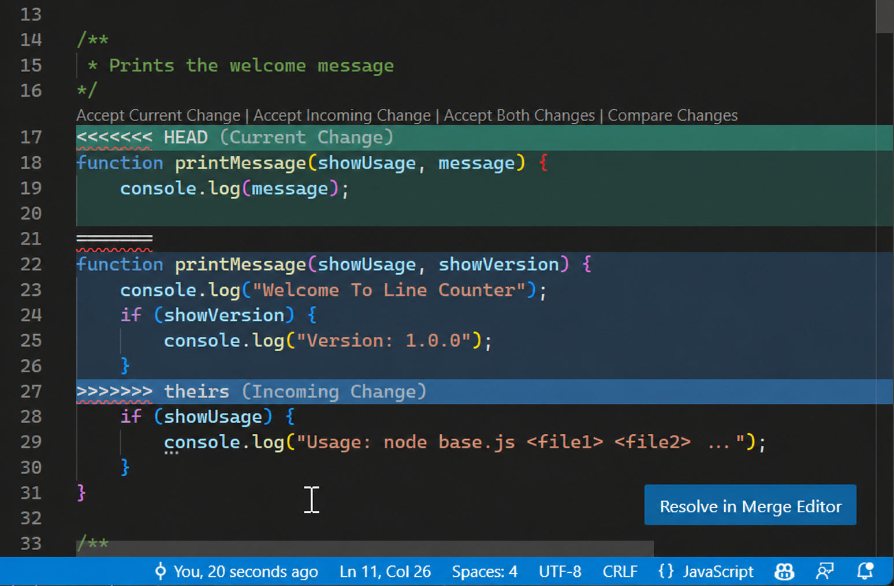

# Cómo trabajar en grupo y resolver un merge

En este práctico dos o tres personas trabajan sobre la misma rama. Es normal
que dos integrantes hagan cambios antes de que alguno pueda subirlos. Git suele
combinarlos automáticamente; sólo pide ayuda cuando las modificaciones afectan
las mismas líneas o zonas muy cercanas.

Un conflicto de merge **no significa que se haya perdido trabajo**. Significa
que Git encontró dos versiones razonables y necesita que el grupo decida cuál
debe quedar.

## Una rutina que evita la mayoría de los conflictos

Antes de empezar una tarea:

1. Acuerden quién tocará cada archivo o función. Dos personas pueden trabajar
   en paralelo, pero conviene evitar que editen simultáneamente las mismas
   líneas.
2. Desde la raíz del repositorio, actualicen su copia:

   ```bash
   git status
   git pull --no-rebase
   ```

3. Trabajen y hagan commits chicos, cada uno con una idea completa:

   ```bash
   git add ruta/del/archivo.py
   git commit -m "Controla la cuadratura contra Rutherford"
   ```

4. Antes de subir, incorporen lo que hayan publicado sus compañeros:

   ```bash
   git pull --no-rebase
   uv run pytest
   git push
   ```

El segundo `pull` es importante. Si otra persona hizo `push` mientras ustedes
trabajaban, permite combinar ambos trabajos localmente y probar el resultado
antes de publicarlo.

> No usen `git push --force` para resolver un rechazo del servidor. En una
> rama compartida puede borrar commits de sus compañeros.

## Qué ocurre cuando hay un conflicto

Supongamos que dos personas cambiaron la misma asignación. Al hacer
`git pull --no-rebase`, Git puede mostrar un mensaje como:

```text
CONFLICT (content): Merge conflict in analisis.py
Automatic merge failed; fix conflicts and then commit the result.
```

En VS Code, abran **Source Control** (`Ctrl+Shift+G` o `Cmd+Shift+G` en macOS).
El archivo aparecerá bajo **Merge Changes**. Al abrirlo, el editor puede
mostrar el conflicto directamente dentro del archivo:



### Las marcas dentro del archivo

- **`<<<<<<< HEAD`** señala el comienzo de la primera versión. `HEAD` es el
  nombre que usa Git para el commit actualmente activo. En este flujo contiene
  normalmente el commit local que acaban de hacer.
- **`Current Change`** es el nombre que VS Code da a esa primera versión: el
  contenido que ya estaba en la rama activa cuando comenzó el merge.
- **`=======`** separa las dos versiones enfrentadas. No forma parte del
  programa.
- **`>>>>>>> theirs`** marca el final de la segunda versión. `theirs` significa
  “la versión de ellos”: la que está entrando desde la otra rama o desde los
  commits remotos. Según cómo se inició el merge, Git puede mostrar en su lugar
  el nombre de una rama o de un commit.
- **`Incoming Change`** es el nombre que VS Code da a esa versión entrante. En
  este flujo suele contener los commits que sus compañeros ya subieron.

Los colores sólo ayudan a distinguir los bloques; no indican cuál es correcto.
Además, “Current” e “Incoming” describen el papel de cada versión en esta
operación de Git, no qué persona tiene razón. En operaciones distintas, como
un `rebase`, la interpretación puede resultar menos intuitiva; por eso esta
guía usa merges explícitos con `git pull --no-rebase`.

### Las acciones que ofrece VS Code

- **Accept Current Change:** conserva el bloque entre `<<<<<<< HEAD` y
  `=======`, y descarta el bloque entrante.
- **Accept Incoming Change:** conserva el bloque entre `=======` y
  `>>>>>>> theirs`, y descarta el bloque actual.
- **Accept Both Changes:** conserva los dos bloques, normalmente uno a
  continuación del otro. No combina el significado del código: después hay
  que revisar el orden y eliminar repeticiones o contradicciones.
- **Compare Changes:** abre una comparación de ambas versiones para poder
  inspeccionarlas con más espacio antes de decidir. No resuelve el conflicto.
- **Resolve in Merge Editor:** abre otra interfaz de VS Code que presenta por
  separado la versión actual, la entrante y el resultado editable. Es otra
  vista del mismo conflicto, no una operación distinta de Git.

Aceptar una opción no garantiza que el programa quede bien. Por ejemplo, si
una versión usa `tolerancia = 1e-6` y la otra `tolerancia = 1e-8`, combinar
ambas líneas dejaría dos asignaciones y ocultaría la decisión importante. El
grupo debe entender por qué existen las dos versiones y editar el archivo para
dejar una sola decisión justificada.

También pueden resolver sin pulsar ninguna de las acciones: editen el bloque
manualmente hasta dejar exactamente el código que quieren conservar. Por
ejemplo, un conflicto simple puede verse así:

```text
<<<<<<< HEAD
tolerancia = 1e-6
=======
tolerancia = 1e-8
>>>>>>> origin/main
```

La parte superior corresponde a `Current Change` y la inferior a `Incoming
Change`. Resuelvan el contenido y borren **también** las tres líneas de
marcadores (`<<<<<<<`, `=======` y `>>>>>>>`). Los botones de VS Code hacen
esta eliminación automáticamente para el bloque elegido.

## Cómo terminar el merge

Para cada archivo en conflicto:

1. Comparen ambas versiones y, si la intención no está clara, hablen con quien
   hizo el otro cambio.
2. Dejen en el archivo el contenido final y guárdenlo.
3. Comprueben que no queden marcadores de conflicto:

   ```bash
   git diff --check
   git status
   ```

4. Ejecuten los tests y, si corresponde, los experimentos afectados:

   ```bash
   uv run pytest
   ```

5. Marquen los archivos como resueltos y completen el merge:

   ```bash
   git add ruta/del/archivo.py
   git commit
   git push
   ```

VS Code también permite hacer `Stage Changes` y luego **Commit** desde Source
Control. Antes de pulsar **Sync Changes**, verifiquen que los tests pasen y que
`git status` no enumere conflictos pendientes.

## Si necesitan volver atrás

Mientras el merge todavía no fue confirmado con un commit, pueden cancelarlo:

```bash
git merge --abort
```

Esto devuelve el repositorio al estado anterior al merge. Úsenlo si empezaron
a resolver sin entender los cambios o si necesitan hablar primero con el
grupo. Luego pueden volver a ejecutar `git pull --no-rebase`.

## Cuándo pedir ayuda

No adivinen ni elijan “Accept Current” o “Accept Incoming” sólo para que
desaparezca el aviso. Consulten al grupo o al equipo docente si:

- no entienden qué buscaba alguno de los cambios;
- ambas versiones modifican una fórmula, una tolerancia o una interpretación
  física;
- el conflicto afecta datos o archivos generados;
- los tests pasaban por separado pero fallan después de combinarlos;
- Git informa un estado distinto de un merge común.

La resolución correcta no es la que deja a Git en silencio: es la que conserva
la intención de ambos trabajos, pasa los controles y puede ser explicada por el
grupo.
